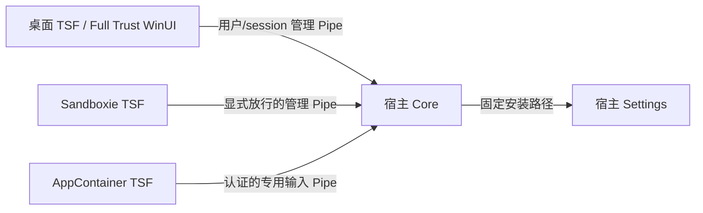

# Windows 现代应用输入支持方案

## 当前状态与边界

AppContainer 输入传输、TSF 候选 UIElement/Behavior、敏感 context 透传和可选登录启动已接入，当前 IPC 为 v10。真实 AppContainer token 与免注册 TSF probe 不能代替 Windows 向已注册 TIP 的真实派发、签名安装和完整 UWP 验收。

目标为 Windows 11 x64 的普通文本输入。Terminal、Full Trust WinUI/XAML 和真正的 AppContainer 分别验收；package identity 或从 Store 安装不能单独证明 AppContainer 身份。安全桌面、完整密码支持、触摸键盘专用布局、搜索集成、完整无障碍、ARM64/x86 不在当前支持声明内。

引擎、配置、学习数据和 Settings 由宿主 Core 管理。AppContainer TSF 直接连接同一 Core 的专用 Named Pipe，无桥接进程或 RPC。Sandboxie 保留原有宿主共享行为，详见 [Sandboxie 配置](windows-sandboxie-design.md)。

## 环境与运行策略

`win32/ipc/clientenvironment.h` 汇总 Sandboxie、token 和 package 事实，包括 SID、session、AuthenticationId、完整性和 AppContainer SID。`SandboxieApi` 继续只负责第三方查询，`isolationpolicy.h` 将环境映射为 `HostServices`、`HostOnly`、`RestrictedInput` 或 `Refuse`。

| 宿主环境 | 连接与服务 | UI |
| --- | --- | --- |
| 普通中完整性桌面，包括 Full Trust 打包应用 | 既有管理 Pipe；可按现有策略后台启动 Core | 候选显示经过 UIElement 协商 |
| Full Trust immersive/UIElement-only | 按真实 token 决定权限，不因 immersive 一律禁止服务操作 | 系统 TSF 菜单；遵守宿主显示许可 |
| Sandboxie，非 AppContainer | 原 Pipe，HostOnly；不创建 ServiceController 或本地 Core/Settings/control 子进程 | 保留兼容行为并遵守 UIElement 协商 |
| AppContainer | 专用输入 Pipe；不访问本地服务 mutex/state 或启动 Core/Settings | 宿主 UIElement；仅获许可且有合法位置时自绘候选；菜单仅 Settings |
| 低完整性桌面或未知环境 | 禁止本地服务操作；token 查询失败时 Pipe 客户端拒绝连接 | 不以检测失败提升权限 |
| Sandboxie 与 AppContainer 叠加 | Refuse，不尝试绕过隔离 | 按键透传 |

Core 和 Settings 入口在读取用户配置、创建服务对象前要求 `HostServices`，拒绝沙箱、AppContainer、低完整性和未知环境。HostOnly 客户端通过 `GetGlobalSettings` 使用宿主解析后的语言，不读取隔离视图中的用户配置；翻译资源仍来自安装树。受限客户端以宿主握手为准，不从不可见的本地安装 marker 推断服务许可。

TSF 保存 `ActivateEx` flags 并查询 `ITfThreadMgrEx::GetActiveFlags`；`TF_TMF_IMMERSIVEMODE` 不等同于 AppContainer。语言栏是可选接口，缺少 manager 或 AddItem 失败不阻止必需输入接口初始化；必需 sink 失败则回滚。secure、COM-less、WOW16 等未实现环境透传，不依赖激活失败替 Windows 决定回退。

## 进程与传输

### Endpoint 与身份

桌面和 Sandboxie 保留 `\\.\pipe\fcitx5-windows-v2-<SID>-<session>`。`v2` 是历史名称，不是 framing 版本；AppContainer 使用相同基名加 `-input`。两入口使用 message mode、拒绝远程客户端、首实例保护、overlapped I/O 和有限等待/取消。客户端使用 `SECURITY_IDENTIFICATION` SQOS。

输入入口 DACL 给予当前用户完整权限，`ALL APPLICATION PACKAGES` 仅 `0x100183` 客户端权限，排除 `FILE_CREATE_PIPE_INSTANCE`。仅此入口设置低完整性 `NW` label；管理入口不放宽 ACL。AAP ACE 不是用户边界：服务端读取有界 Hello 后，通过 Pipe 模拟 token 检查实际用户 SID、session、AuthenticationId 及 AppContainer 身份，然后解除模拟，再处理引擎或配置。身份查询失败关闭连接，解除模拟失败不得继续复用该线程。

Sandboxie 安全模式可能让宿主看到匿名 token。仅既有用户 DACL 已授权打开、token 查询成功、非 AppContainer 的管理连接可使用匿名 SID 例外，并继续核对内核 peer session；受限输入入口仍要求同一登录身份。详见 [Sandboxie 进程策略](windows-sandboxie-design.md#进程策略)。

AppContainer 无法直接打开宿主 token，因此使用 `AuthenticateServer` 握手：已认证的服务端复制仅 `PROCESS_QUERY_LIMITED_INFORMATION | READ_CONTROL` 的进程句柄到客户端。客户端核对内核 Pipe PID/session、句柄 PID、进程对象 owner 和安装树固定 `bin/Fcitx5.exe` 路径，再发送输入。句柄不授予内存、token 或进程控制权限。该保证依赖受保护的安装树，不隔离同用户任意代码执行，也不等同于签名验收。

全局命名已由真实 AppContainer token probe 覆盖，`LOCAL\` 名称单独诊断；生产不会自动切换或替换桌面名称。LPAC、hardened token 和其他沙箱组合尚未全面验证，不通过 Everyone ACL 扩大兼容范围。

### 请求与资源限制

Hello 和受限认证帧的读取各有 2 秒等待上限，受限请求投递后等待 Core 最多 2 秒。两入口共享最多 64 个连接，其中受限入口最多 16 个；每个受限连接最多 4 个 context，请求体最多 64 KiB，空闲 60 秒断开。输入入口初始化失败不停止桌面入口；关闭连接按 owner 清理 context。

| 请求 | AppContainer 权限 |
| --- | --- |
| Hello、创建/销毁 context、focus、key、poll、reset | 允许，仅限本连接拥有的 context |
| 当前输入法选择/轮换、键盘开关 | 允许，不修改用户有序列表 |
| 候选选择/确认/取消 | 允许，校验焦点、稳定候选代次和索引 |
| GetGlobalSettings | 只读 UI 语言/日志状态 |
| OpenSettings | 固定宿主命令，全局限流；客户端“用户点击”字段不作为授权 |
| 配置写入、词库路径查询、打开用户目录、重启/停止服务 | 拒绝；由宿主 Settings/桌面菜单管理 |
| 未知消息、任意路径/命令、跨连接 context 操作 | 拒绝 |

专用入口始终使用受限策略；既有入口遇到 AppContainer token 同样限制请求，不因入口名称获得管理权限。受限输入状态回复移除图标路径。Settings 由宿主按固定路径启动后，通过管理入口修改配置，不需要改变其 framework-dependent 部署方式。

实际按键仍同步等待 Core 消费结果，测试回调只观察状态。超时请求不重放，跨进程故障无 exactly-once 保证；迟到回复不能写入新焦点。挂起、退出或断线后清理旧 context，恢复时建立新代次。

## Core 启动与停止

AppContainer 和 Sandboxie TSF 要求宿主 Core 已运行。安装器提供默认不选中的当前用户登录启动任务，固定命令为 `Fcitx5.exe --login-start`，遵守本登录会话的手动停止状态。卸载 helper 只清理本安装树拥有的启动值，保留其他路径的同名值。普通构建、部署和 probe 不创建启动项。

手动“关闭服务”继续暂停自动启动，受限客户端只能报告不可用并重连；需在宿主重启服务。服务停止时取消所有入口 I/O、释放连接及其 context，再退出 Core。没有额外常驻代理或按进程名终止应用。真实登录后的首次 UWP 输入、升级/卸载启动项清理仍需系统验收。

## Context 与编辑

所有 composition/commit 仍在 TSF owning thread 的合法 edit session 中执行，校验原 context、generation、快照和 settings epoch。不使用 SendInput、剪贴板或 HWND 消息替代 TSF 提交。

新焦点仅恢复当前输入法条目，不迁移旧预编辑。失焦、context pop、deactivate、断线等路径结束候选 UIElement 并拒绝迟到编辑。密码/numeric-password scope、只读、keyboard-disabled 和 empty context 不向引擎发送输入；敏感状态变化清理旧 composition。

scope getter 的空 `E_FAIL` 作为 TSF 缺失属性兼容状态，其他查询失败透传；不据此声称已识别所有密码控件。完整安全桌面/密码输入仍未实现，不注册 `SECUREMODE` 或 `COMLESS`。

## 候选 UIElement 与自绘窗口

`CandidateUIElement` 实现 `ITfUIElement`、`ITfCandidateListUIElement` 和 `ITfCandidateListUIElementBehavior`，持有不可变候选快照。getter 仅访问内存，初始化输出并遵守 BSTR/COM 引用计数，不请求 Core 或 edit session。

| 状态 | 行为 |
| --- | --- |
| 首次候选 | BeginUIElement，保存有效 ID 与宿主返回的 pbShow |
| pbShow=TRUE | 位置有效才显示自绘窗口 |
| pbShow=FALSE / Show(FALSE) | 隐藏自绘，保留快照供宿主读取；IsShown 反映实际自绘状态 |
| 数据/选择/页变化 | 先替换快照，再 UpdateUIElement，使用相应 TF_CLUIE_* flags |
| Show(TRUE) | 重新请求合法位置，校验宿主/context 后显示 |
| 候选消失、失焦、代次变化、断线、deactivate | 对有效 ID EndUIElement 一次，断开动作与原 Tsf 的关联 |
| Begin/Update 失败 | 保留 composition；immersive/UIElement-only 不擅自自绘 |

候选数据与 HWND/几何分离：宿主接管、没有 HWND、popup 创建失败或 `TS_E_NOLAYOUT` 不删除宿主候选快照。自绘需要可验证的同宿主 owner 和合法坐标，不使用任意前台窗口替代。几何暂缺、零尺寸 input-site 和 clipped caret 处理见 [候选渲染](windows-candidate-rendering.md)。对象结束后外部 COM 引用仍可释放，但动作不得回调已失效的 Tsf；通知重入不得观察半更新状态。

### 批次、分页与动作

`GetCount` 为当前有界批次数量，`GetString` 返回正文，索引从 0 开始，标签/注释不混入提交。无选择时 GetSelection 初始化输出并返回 S_FALSE。默认是当前批次的一页；SetPageIndex 验证有序起点和边界，在同一批次内保存宿主分页。`hasPrev/hasNext` 不代表引擎总页数，getter 不枚举完整或无限候选集合。

SetSelection、Finalize、Abort 捕获候选身份进入 owning-thread 队列，通过 `CandidateAction` 请求 Core，不能重入编辑或合成选词按键。Core 在主线程检查 owner、焦点、`candidateGeneration`、索引及引擎能力，再调用真实 CandidateWord/游标抽象。内容、引擎页和输入法改变使身份失效，普通 poll 不改变身份；游标动作维护已验证的身份过渡。TSF 最终提交仍来自 Core 回复，不直接写入 getter 文本。

宿主 Behavior 已接通且有免注册 probe，自绘 popup 仍无鼠标交互；完整无障碍及真实宿主交互仍需验收。

## 指示器与其他 UI

保留 GUID_LBI_INPUTMODE，keyboard open/close 由实际条目推导；左键/Ctrl+Space 轮换用户有序列表。immersive/UIElement-only 使用 ITfMenu/InitMenu/OnMenuSelect，AppContainer 菜单仅保留 Settings。桌面原生菜单和 About 也通过辅助 UIElement 协商，服务错误只输出诊断，不弹出未经许可的 MessageBox。

跨屏 DPI、主题、触摸键盘遮挡及系统搜索仍需独立验证/实现，不使用 undocumented window-band、全局 topmost 或抢焦点解决层级问题。

## 注册、签名与安装

`build-and-deploy.ps1 -ModernApps` 对应 `ENABLE_MODERN_TSF_CATEGORIES=ON`，声明 UIELEMENTENABLED 和 IMMERSIVESUPPORT；本地默认关闭，CI/Nightly 显式启用。keyboard/display attribute/SYSTRAYSUPPORT 保留，其他未实现 category 不声明。

更改构建选项或替换 DLL 不更新既有注册，必须显式安装或重新注册。安装 smoke 检查实际 COM DLL 路径/threading model、启用的 profile 和现代 category 的双向索引；缺少声明阻止 Nightly 发布。此检查仅证明注册，CI 当前没有发行签名或真实现代应用派发测试。

正式兼容验收仍需签名 TSF、受保护安装树、可读资源和交互系统测试。未签名开发目录上的可加载结果不代表全部现代宿主允许加载。普通 build/deploy/probe 不签名、注册或安装包；安装 smoke 是专门的系统测试。

## 实现与自动化入口

| 文件/模块 | 职责 |
| --- | --- |
| win32/ipc/clientenvironment.h、isolationpolicy.h、pipeidentity.h | 环境、策略、双向身份及输入入口 ACL |
| src/windowsfrontend.*、win32/ipc/protocol.h | 多入口生命周期、配额、消息允许列表、主线程候选动作 |
| TextInputProcessorEx.cpp、contextpolicy.cpp、ThreadMgrEventSink.cpp | 激活、可选语言栏、敏感 context 与代次清理 |
| candidateuielement.*、EditSession.cpp、candidatewindow.* | 不可变快照、显示协商、动作队列和位置/数据分离 |
| langbaritem.*、auxiliaryuielement.h、servicecontrol.cpp、pollstate.cpp | 菜单/UI 权限、HostOnly 和重连 |
| win32/setup/startup.h、src/main.cpp、installer/fcitx5.iss | 可选登录启动、手动停止及安装路径归属 |

- `test_isolationpolicy`、`test_pipeidentity`：环境/消息策略、真实 Pipe peer 身份及 Sandboxie 匿名 token 例外。
- `test_candidateuielement`、`test_candidate_tsf`：getter/分页、Show、Begin/Update/End、无 HWND、layout、敏感 context 和迟到 session。
- `test_register` / `test_register_other`、`test_startup`：两种 category 构建设置及模拟启动项归属，不修改系统注册。
- `appcontainer_probe <现有 profile/package family name>`：真实 x64 受限 token、隔离诊断 Pipe、全局/LOCAL 命名、身份、message mode、deadline 和取消，不创建或修改 profile。
- `scripts/test-modern-apps.ps1`：要求 Core 和 TSF/probes 均以 FCITX5_UI_TEST 构建，使用隔离服务对象/用户目录，运行 modern_input_probe 的真实受限引擎/候选动作/免注册 TSF 和桌面 probes。它会部署 DLL/probe 到传入前缀，只能指向测试运行树。
- `ENABLE_UWP_FIXTURE=ON`：构建未签名、未安装的原生 UWP TextBox/RichEditBox/PasswordBox fixture。

命令及前提见 [现代应用验收](build.md#modern-app-acceptance)。详细日志使用共享异步 JSON Lines logger，开关从 Core 同步。目录属于当前进程的 LocalAppData 视图，受限宿主可能重定向或不可写，日志失败不影响输入；隐私与收集方式见 [开发诊断](windows-developer-logging-design.md)。

## 剩余验收矩阵

| 验证层 | 待确认 | 现有自动化不能证明 |
| --- | --- | --- |
| 注册后的现代桌面 | Terminal、Full Trust WinUI，选择/预编辑/提交、菜单、焦点/模式切换 | Windows 实际派发及窗口层级 |
| 注册后的 AppContainer | UWP fixture、系统设置普通文本框，候选动作、挂起/恢复、Core 缺失/停止/重连 | 所有 UWP/自定义控件或完整密码行为 |
| 正式安装 | 签名/保护资源、登录启动、干净登录首次输入、升级/卸载 | 打包、注册 smoke 或用户可写开发目录不能替代交互验收 |
| 回归 | 普通 Win32、Sandboxie、多用户/session、物理 DPI/主题/触摸键盘 | 单一 token 或模拟 context 不能代替宿主矩阵 |

真实验收记录 OS build、应用版本、架构、token/active flags、注册 DLL 路径/签名、Pipe 名、Core 启动前提以及候选由谁绘制。分别报告派发、IPC、编辑和渲染失败；成功注册、Hello 或固定字符提交不能替代真实引擎输入。

## 参考

- [自定义 IME 要求](https://learn.microsoft.com/en-us/windows/apps/develop/input/input-method-editor-requirements)
- [TSF category](https://learn.microsoft.com/en-us/windows/win32/tsf/predefined-category-values)
- [ActivateEx](https://learn.microsoft.com/en-us/windows/win32/api/msctf/nf-msctf-itftextinputprocessorex-activateex) 与 [GetActiveFlags](https://learn.microsoft.com/en-us/windows/win32/api/msctf/nf-msctf-itfthreadmgrex-getactiveflags)
- [UILess Mode](https://learn.microsoft.com/en-us/windows/win32/tsf/uiless-mode-overview) 与 [BeginUIElement](https://learn.microsoft.com/en-us/windows/win32/api/msctf/nf-msctf-itfuielementmgr-beginuielement)
- [GetWnd](https://learn.microsoft.com/en-us/windows/win32/api/msctf/nf-msctf-itfcontextview-getwnd)
- [Windows 应用 IPC](https://learn.microsoft.com/en-us/windows/apps/develop/communication/interprocess-communication) 与 [Named Pipe 权限](https://learn.microsoft.com/en-us/windows/win32/ipc/named-pipe-security-and-access-rights)
