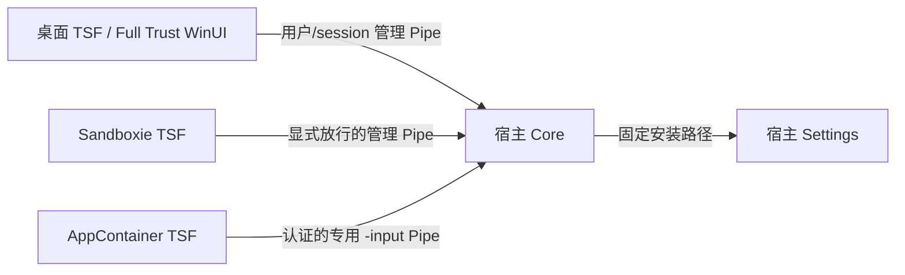

# Windows 现代应用输入支持方案

## 当前状态与边界

AppContainer 输入传输、TSF 候选 UIElement/Behavior、敏感 context 透传和可选登录启动均已接入，当前 IPC 为 **v17**。自动化覆盖真实 AppContainer token 和免注册 TSF context；已注册 TIP 派发、签名部署与真实 UWP 应用矩阵见文末验收表。

支持范围为 Windows 10 1809+ / Windows 11 x64 的普通文本输入（Terminal、Full Trust WinUI/XAML 和 AppContainer 按实际 token 分别验收）。x86 TSF 已有构建与桌面 probe，现代应用的真实 x86 派发、安全桌面、完整密码输入、触摸键盘专用布局、搜索集成、完整无障碍和 ARM64 TSF 尚待实现或验收。

引擎、配置、学习数据和 Settings 统一由宿主 Core 管理。AppContainer TSF 直接连接同一 Core 的专用 Named Pipe，无桥接进程或 RPC。Sandboxie 宿主共享见 [Sandboxie 配置](windows-sandboxie-design.md)。

## 环境与运行策略

`win32/ipc/clientenvironment.h` 汇总 Sandboxie、token 与 package 信息（SID、session、`AuthenticationId`、完整性与 AppContainer SID），`isolationpolicy.h` 将其映射为 `HostServices`、`HostOnly`、`RestrictedInput` 或 `Refuse`。

| 宿主环境 | 连接与服务 | UI |
| --- | --- | --- |
| 普通中完整性桌面（含 Full Trust 打包应用） | 管理 Pipe；可按策略后台启动 Core | 候选显示经 UIElement 协商 |
| Full Trust immersive / UIElement-only | 按真实 token 决定权限 | 系统 `ITfMenu`；遵守宿主显示许可 |
| Sandboxie（非 AppContainer） | 管理 Pipe，HostOnly；不启动本地 Core/Settings/控制子进程 | 遵守 UIElement 协商 |
| AppContainer | 专用 `-input` Pipe；不访问本地服务状态或启动 Core/Settings | 宿主 UIElement；仅获许可且有有效位置时自绘候选；菜单仅 Settings |
| 低完整性桌面或未知环境 | 禁止本地服务操作；token 查询失败时拒绝连接 | 不提升权限 |
| Sandboxie 与 AppContainer 叠加 | Refuse | 按键透传 |

Core 与 Settings 启动前强制要求 `HostServices`，拒绝沙箱、AppContainer、低完整性和未知环境。HostOnly / 受限客户端通过 `GetGlobalSettings` 使用宿主解析后的 UI 语言（翻译资源仍来自安装树），不读取隔离视图用户配置或本地安装 marker。

TSF 保存 `ActivateEx` flags 并查询 `ITfThreadMgrEx::GetActiveFlags`。语言栏属于可选接口，缺失或 `AddItem` 失败不阻塞核心输入接口初始化；必需 sink 失败则回滚。secure、COM-less、WOW16 等环境直接透传按键。

## 进程与传输

### Endpoint 与身份校验

- 桌面与 Sandboxie 使用 `\\.\pipe\fcitx5-windows-v2-<SID>-<session>`（`v2` 为历史命名，协议为 v17）；AppContainer 使用同名加 `-input`。两入口均采用 message mode、拒绝远程客户端、首实例保护、overlapped I/O 与有限超时取消，客户端使用 `SECURITY_IDENTIFICATION` SQOS。
- 普通桌面管理入口支持 UAC linked-token 身份兼容（见 [UAC 方案](windows-uac-ipc-design.md)）和 Sandboxie 安全模式匿名 token 兼容（见 [Sandboxie 进程策略](windows-sandboxie-design.md#进程策略)）；AppContainer `-input` 入口始终严格匹配同一登录身份。
- `-input` 入口 DACL 授予当前用户完整权限、`ALL APPLICATION PACKAGES` 仅客户端权限（`0x100183`，不含 `FILE_CREATE_PIPE_INSTANCE`）并设置低完整性 `NW` label。服务端读取有界 Hello 后模拟对端 token 校验用户 SID、session、`AuthenticationId` 与 AppContainer 身份，随即解除模拟（解除失败不得复用该线程）。
- **服务端反向认证（`AuthenticateServer`）**：因 AppContainer 无法直接打开宿主 token，已认证服务端复制仅含 `PROCESS_QUERY_LIMITED_INFORMATION | READ_CONTROL` 的自身进程句柄给客户端；客户端核对内核 Pipe PID/session、句柄 PID、进程对象 owner 及安装树固定 `bin/Fcitx5.exe` 路径后再发送输入（依赖安装树写保护）。
- 全局命名已由真实 AppContainer token probe 覆盖，`LOCAL\` 仅用于对比诊断。LPAC 与 hardened token 尚待验证，不放宽 Everyone ACL。

### 请求白名单与资源额度

Hello 与受限认证读取各有 2 秒上限，受限请求等待 Core 最多 2 秒。两入口共限 64 个连接，受限入口最多 16 个连接、每连接最多 4 个 context、请求体上限 64 KiB、空闲 60 秒断开。

| 请求 | AppContainer 权限 |
| --- | --- |
| Hello、创建/销毁 context、focus、key、poll、reset | 允许（限本连接拥有的 context） |
| 当前输入法选择/轮换、键盘开关 | 允许（不改用户有序列表） |
| `CandidateAction`（选择/确认/取消） | 允许（校验焦点、稳定候选代次与索引） |
| `GetGlobalSettings` | 只读 UI 语言、详细日志状态、全局快捷键与候选框布局 |
| `OpenSettings` | 固定宿主命令，全局限流 |
| 配置写入、词库查询、`GetPlugins`、`GetStatusMenu`/`ActivateStatusMenu`、打开用户目录、重启/停止服务 | 拒绝 |

既有管理入口若遇到 AppContainer token 同样套用受限策略；受限回复自动剥离图标路径。按键测试回调仅观察状态，超时请求不重放，迟到回复拒绝写入新焦点。

## Core 启动与停止

AppContainer 与 Sandboxie 要求宿主 Core 已运行。安装器提供默认不选中的当前用户登录启动项（`Fcitx5.exe --login-start`），遵守本登录会话手动停止状态；卸载仅清理本安装路径拥有的项。手动停止服务会取消所有入口 I/O 并退出 Core，受限客户端需在宿主重启后重连。

## Context 与编辑

所有 composition/commit 在 TSF owning thread 的 edit session 内执行，校验原 context、generation、快照与 settings epoch，不借助 `SendInput` 或剪贴板。

新焦点仅恢复当前输入法条目，不迁移旧预编辑。密码 / numeric-password scope、只读、keyboard-disabled 和 empty context 直接透传按键，敏感状态切换清理旧 composition。`GetValue` 返回 `E_FAIL` 视作缺失属性兼容状态，其余查询失败透传。

## 候选 UIElement 与自绘窗口

`CandidateUIElement` 实现 `ITfUIElement`、`ITfCandidateListUIElement` 和 `ITfCandidateListUIElementBehavior`，持有不可变候选快照。所有 getter 仅读内存并遵守 COM/BSTR 引用规则，不访问 Core 或 edit session。

| 状态 | 行为 |
| --- | --- |
| 首次候选 | `BeginUIElement`，保存 ID 与宿主返回的 `pbShow` |
| `pbShow = TRUE` | 位置有效时显示自绘浮窗 |
| `pbShow = FALSE` / `Show(FALSE)` | 隐藏自绘浮窗，保留快照供宿主读取；`IsShown` 反映自绘状态 |
| 数据/选择/页变化 | 先替换快照，再调用 `UpdateUIElement` 并传入对应 `TF_CLUIE_*` |
| `Show(TRUE)` | 重新校验宿主/context 与位置后显示 |
| 候选消失、失焦、代次变化、断线、deactivate | 对有效 ID 调用 `EndUIElement` 一次并解除回调绑定 |
| Begin/Update 失败 | 保留 composition；immersive/UIElement-only 不擅自自绘 |

候选数据与 HWND/几何解耦：宿主接管、无 HWND、popup 创建失败或 `TS_E_NOLAYOUT` 均保留宿主可读快照。自绘弹窗需验证同宿主 owner 与合法坐标（细节见 [候选渲染](windows-candidate-rendering.md)）。

### 批次、分页与宿主动作

- `GetCount` 返回当前有界批次数量，`GetString` 返回 0 基正文（不含标签/注释），无选择时 `GetSelection` 返回 `S_FALSE`；`SetPageIndex` 在当前批次内维护宿主分页。
- `SetSelection`、`Finalize`、`Abort` 捕获候选身份入队，通过 `CandidateAction` 交由 Core 主线程校验 owner、焦点、`candidateGeneration` 和索引后调用真实引擎；最终提交来自 Core 回复。

## 指示器与其他 UI

保留 `GUID_LBI_INPUTMODE`，keyboard open/close 由当前条目是否为键盘推导。immersive/UIElement-only 使用 `ITfMenu`（AppContainer 菜单仅保留设置入口）；桌面原生菜单与关于窗口通过辅助 UIElement 协商显示权限，服务错误仅写诊断日志。

## 注册、签名与安装

`build-and-deploy.ps1 -ModernApps`（`ENABLE_MODERN_TSF_CATEGORIES=ON`）声明 `UIELEMENTENABLED` 和 `IMMERSIVESUPPORT`；CI/Nightly 默认启用，本地默认关闭。修改选项后需安装更新包或显式重新注册生效。CI 安装 smoke 检查双视图 COM 路径/threading model、启用 profile 与现代 category 双向索引，缺失声明阻止 Nightly 发布。代码签名与真实现代应用交互验收尚待完成。

## 实现与自动化入口

| 文件 / 模块 | 职责 |
| --- | --- |
| `win32/ipc/clientenvironment.h`、`isolationpolicy.h`、`pipeidentity.h` | 环境检测、策略映射、双向身份与 `-input` ACL |
| `src/windowsfrontend.*`、`win32/ipc/protocol.h` | 多入口生命周期、配额、白名单与主线程候选动作 |
| `TextInputProcessorEx.cpp`、`contextpolicy.cpp`、`ThreadMgrEventSink.cpp` | 激活、可选语言栏、敏感 context 与代次清理 |
| `candidateuielement.*`、`EditSession.cpp`、`candidatewindow.*` | 不可变快照、显示协商、动作队列与位置/数据解耦 |
| `langbaritem.*`、`auxiliaryuielement.h`、`servicecontrol.cpp`、`pollstate.cpp` | 菜单/UI 权限、HostOnly 与重连 |
| `win32/setup/startup.h`、`src/main.cpp`、`installer/fcitx5.iss` | 可选登录启动、手动停止与安装路径归属 |

自动化验证入口（命令见 [build.md](build.md#modern-app-acceptance)）：

- CTest：`test_isolationpolicy`、`test_pipeidentity`、`test_candidateuielement`、`test_candidate_tsf`、`test_register`、`test_register_other`、`test_startup`。
- `appcontainer_probe <profile/PFN>`：真实 x64 受限 token、全局与 `LOCAL\` 命名对比、双向身份、message mode、超时与取消。
- `scripts/test-modern-apps.ps1`：使用 `FCITX5_UI_TEST` 构建与隔离配置运行 `modern_input_probe`（真实受限引擎、候选动作、免注册 TSF 与桌面 probe）。
- `ENABLE_UWP_FIXTURE=ON`：构建未签名的原生 UWP `TextBox`/`RichEditBox`/`PasswordBox` 验收夹具。

## 剩余验收矩阵

| 验证层 | 待确认对象 | 验收重点 |
| --- | --- | --- |
| 现代桌面宿主 | Windows Terminal、Full Trust WinUI | 实际 OS 派发、预编辑/提交、菜单、焦点/模式切换与窗口层级 |
| AppContainer 宿主 | UWP fixture、系统设置文本框 | 实际 UWP 宿主候选动作、挂起/恢复、Core 缺失/重连与密码框行为 |
| 正式安装 | 签名/受保护安装树、登录启动 | 干净登录首次输入、升级与卸载 |
| 跨宿主回归 | Win32、Sandboxie、多用户/session、混合 DPI/主题/触摸键盘 | 全宿主矩阵兼容性 |

验收时记录 OS build、应用版本、架构、token/active flags、注册 DLL 路径/签名、Pipe 名、Core 启动状态及候选渲染方。

## 参考

- [自定义 IME 要求](https://learn.microsoft.com/en-us/windows/apps/develop/input/input-method-editor-requirements)
- [TSF category](https://learn.microsoft.com/en-us/windows/win32/tsf/predefined-category-values)
- [ActivateEx](https://learn.microsoft.com/en-us/windows/win32/api/msctf/nf-msctf-itftextinputprocessorex-activateex) 与 [GetActiveFlags](https://learn.microsoft.com/en-us/windows/win32/api/msctf/nf-msctf-itfthreadmgrex-getactiveflags)
- [UILess Mode](https://learn.microsoft.com/en-us/windows/win32/tsf/uiless-mode-overview) 与 [BeginUIElement](https://learn.microsoft.com/en-us/windows/win32/api/msctf/nf-msctf-itfuielementmgr-beginuielement)
- [Windows 应用 IPC](https://learn.microsoft.com/en-us/windows/apps/develop/communication/interprocess-communication) 与 [Named Pipe 权限](https://learn.microsoft.com/en-us/windows/win32/ipc/named-pipe-security-and-access-rights)
