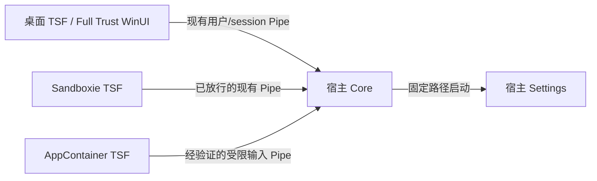

# Windows 现代应用输入支持方案

## 状态与目标

本文保留现代应用输入的分阶段设计。基础运行时链路、候选 UIElement/Behavior、受限 Pipe 和登录启动选项已接入；自动化 AppContainer token/免注册 TSF 验证不代表已经完成真实 UWP 系统派发和签名安装验收。Sandboxie 的宿主共享沿用 [windows-sandboxie-design.md](windows-sandboxie-design.md) 中的行为，协议统一升级至 v9。

目标是 Windows 11 x64 上的现代文本输入：Windows Terminal、WinUI/XAML 桌面应用和真正的 AppContainer 应用，可以选择 Fcitx5、使用真实引擎进行 composition/候选/提交，并正确处理焦点、输入法轮换和服务重连。先解决普通文本框，再扩展覆盖；不把安全桌面、密码输入、触摸键盘专用布局、系统搜索集成、ARM64/x86 或完整无障碍能力并入首轮支持声明。

推荐分两步交付：先实现现代桌面宿主的 TSF/UIElement 契约，再实现 AppContainer 的受限输入入口。引擎、用户配置、学习记录和 Settings 继续由宿主 Core 管理。传输优先验证并复用 Named Pipe，沿用现有 framing、超时、取消和 context 归属机制；RPC 只在 Pipe 存在经实测确认的兼容阻塞时作为备选。

能否建立 AppContainer 连接与连接后允许哪些协议操作是两个独立问题。权限限制可在 Pipe 服务端实现，不以引入 RPC 为前提。首选架构由 AppContainer TSF 直接连接宿主 Core，不预先增加桥接进程、IDL 或一次转接。

### 已接入的实现

- `ClientEnvironment` 汇总 token、package identity 和 Sandboxie 事实；`IsolationPolicy` 决定宿主服务、HostOnly、受限输入或拒绝。Core/Settings 拒绝受限和查询异常环境。
- 桌面/Sandboxie 继续使用原 `v2` Pipe；AppContainer 使用同名加 `-input` 的专用入口，保留 message mode、overlapped I/O、SQOS identification、超时和取消。全局命名通过真实 AppContainer token probe；`LOCAL\\` 命名可在同一 probe 中单独诊断，不自动切换或替换桌面入口。
- 输入入口 DACL 给予当前用户完整权限，`ALL APPLICATION PACKAGES` 仅 `0x100183`，排除 `FILE_CREATE_PIPE_INSTANCE`；仅此入口有低完整性 `NW` label。AAP ACE 不是用户边界：服务端在 Hello 后模拟 identification token，校验用户 SID、session、AuthenticationId 和 AppContainer SID，再解除模拟。
- AppContainer 不能直接打开宿主进程/token。因此 v9 增加 `AuthenticateServer`：服务端复制仅 `PROCESS_QUERY_LIMITED_INFORMATION | READ_CONTROL` 的进程句柄到已经认证的客户端；客户端核对内核 Pipe PID/session、句柄 PID、进程对象 owner 和安装树中固定的 `bin/Fcitx5.exe` 路径，然后才发送输入。句柄不授予进程控制、内存或 token 访问权限。此保证依赖受保护的安装树；不隔离同用户任意代码执行，也不把开发目录验证当作签名部署验收。
- Hello/认证阶段有 2 秒期限。两入口共享最多 64 个连接，受限入口最多 16 个；每个受限连接最多 4 个 context、请求体最多 64 KiB，空闲 60 秒断开。输入入口失败不停止桌面入口；关闭连接按 owner 清理 context。拒绝管理请求和未知消息，固定 Settings 命令全局限流，输入状态回复移除图标路径。
- 激活保留 TSF flags；secure/COM-less/WOW16 透传，语言栏为可选接口。密码/numeric-password scope、只读和 disabled/empty context 不发送引擎输入。scope getter 的空 `E_FAIL` 是 TSF 缺失属性的兼容状态；其他查询失败透传，不能据此声称识别所有密码控件。
- 候选的 Begin/Update/End、Show 和 getter 与 HWND/layout 分离；页面仅描述当前有界批次。Behavior 动作进入 owning-thread 队列，Core 检查 owner、稳定候选代次、焦点和索引，通过真实候选/游标接口处理。普通 poll 不使身份失效，过时代次拒绝。
- immersive/UIElement-only 使用系统菜单，受限菜单仅保留 Settings；桌面原生菜单和 About 也经过 UIElement 显示许可。服务错误只输出诊断，不弹无许可的 MessageBox。
- 安装器提供默认不选中的当前用户登录启动项。固定命令使用 `--login-start`，遵守手动停止状态；显式卸载 helper 清理本安装树拥有的启动项，保留其他安装路径的同名项。普通 build/deploy/test 不写启动项。

`scripts/build-and-deploy.ps1 -ModernApps` 显式启用 `UIELEMENTENABLED` 和 `IMMERSIVESUPPORT` 构建声明。本地构建默认关闭；CI/Nightly 显式启用，使共享运行树和两种安装包具备现代应用选择所需的能力声明。该选项不注册 DLL、不签名、不启动服务；实际安装才更新系统注册，替换 DLL 不会补齐旧的 category。首次受限输入要求宿主 Core 已运行，或用户在安装器中选择登录启动。验证和 fixture 构建见 [build.md](build.md#modern-app-acceptance)。

## 宿主分类与已有缺口

“使用 WinUI/XAML”“从 Microsoft Store 安装”“有 package identity”都不能单独证明进程处于 AppContainer。Terminal 的打包桌面进程与真正的 UWP 应用必须分别验收；系统设置的实际 TSF 宿主也通过运行时诊断确认，不根据窗口名称分类。

| 维度 | 获取依据 | 决定的行为 |
| --- | --- | --- |
| TSF 激活环境 | 保存 `ActivateEx(dwFlags)`，查询 `ITfThreadMgrEx::GetActiveFlags` | immersive、UIElement-only、secure、COM-less、console 的输入/UI 策略 |
| 进程权限 | 当前进程 token 的 `TokenIsAppContainer`、`TokenIntegrityLevel`、`TokenUser`、`TokenSessionId` | 是否允许本地服务操作、使用哪种 Pipe 连接策略 |
| 包身份 | package API、`TokenAppContainerSid` | 诊断与服务端身份核对，不代替权限检查 |
| Sandboxie | 现有 `SandboxieApi` | 保留已实现的 HostOnly 和服务端归属检查 |
| 当前 context | keyboard-disabled/empty-context compartment、context 状态、InputScope | 是否可接收引擎输入、是否必须取消 composition |

`TF_TMF_IMMERSIVEMODE` 从 thread manager 的 active flags 获取，不虚构 `TF_TMAE_IMMERSIVEMODE`，也不把它等同于 `TokenIsAppContainer`。权限查询失败采用 HostOnly/禁止本地启动；TSF flags 查询失败则保留已知 flags 并记录缺失项，不因此把所有普通桌面 context 判为不可用。COM-less/secure 等未实现环境进入无副作用的输入透传状态；不能仅依赖 `ActivateEx` 返回失败让 Windows 自动回退，该方法的返回值并不是可靠的系统回退契约。

### 环境检测抽象

不要把现有 `SandboxieApi` 改名为泛化的 `IsolationApi` 或 `EnvironmentApi`。它直接动态查询 `SbieDll.dll`，职责仍是 Sandboxie 原生适配器：查询某个 PID 的 Sandboxie 状态，以及确认 Pipe 服务端是否为宿主进程。保留这个名称可以让第三方 API 依赖和测试边界保持清楚。

新增 `ClientEnvironment` 作为 TSF/IPC 共用的汇总结果，组合 Sandboxie 查询和 Windows token/package 查询，例如：

```cpp
enum class IsolationKind {
    Host,
    Sandboxie,
    AppContainer,
    SandboxieAppContainer,
    Unknown,
};

struct ClientEnvironment {
    IsolationKind isolation;
    std::wstring userSid;
    DWORD sessionId;
    bool lowIntegrity;
    bool hasPackageIdentity;
};
```

`ClientEnvironment` 只描述事实，不直接决定是否启动服务或开放请求。另设 `IsolationPolicy`（或等价的策略函数）根据汇总结果选择 `HostServices`、`HostOnly` 或 `Refuse`，以及现有 Pipe、专用输入 Pipe、服务启动和 UI 行为。这样 AppContainer 支持不会把 Windows token 逻辑塞进 Sandboxie 查询类。

现有 `SandboxieApi::hostOnly()` 语义过于含糊：它把 `Boxed` 和 `Unknown` 都归入“非宿主”。底层适配器应优先提供 `isHostProcess()`、`isSandboxedProcess()`、`isUnknownProcess()` 或直接返回已有 `SandboxState`；“未知环境按 HostOnly 处理”由 `IsolationPolicy` 决定。`hostServicesAllowed()`、`requireHostServices()` 等上层接口也应基于策略结果命名，不把检测结果伪装成权限结论。

实施前的主要缺口：

- `win32/dll/register.cpp` 仅注册 keyboard、display attribute 和 `SYSTRAYSUPPORT`；`test_register` 明确排除 `IMMERSIVESUPPORT`、`UIELEMENTENABLED` 和 `SECUREMODE`。
- `TextInputProcessorEx.cpp` 忽略激活 flags，语言栏初始化失败会使整个激活失败。
- `Tsf` 没有候选 UIElement；`CandidateWindow` 直接显示 popup，宿主不能接管候选显示。
- `langbaritem.cpp` 的原生右键菜单创建临时窗口并抢前台，不适合作为 immersive/UI-less 路径。
- `PipeClient` 的 HostOnly 检测目前针对 Sandboxie。安装状态、服务状态、用户 UI 配置等读取仍需扩展受限宿主策略。
- Core Pipe 只授权用户 SID，包含输入、全局配置写入及服务控制。直接扩大 ACL 会把整个管理接口暴露出去。
- `KeyReply` 只有有界的当前候选批次、选中项和前后页布尔值，不提供整个引擎候选集合；`revision` 随快照生成递增，不能直接充当稳定候选身份。

## 运行时策略

新增 `ClientEnvironment` 和 `IsolationPolicy`，底层复用 `SandboxieApi` 及 Windows token 查询；不要把 AppContainer 判断塞进 Sandboxie 查询函数。TSF 的策略在每次激活确定，context 的可输入状态随焦点/context 变化更新。Core 和 Settings 入口都在读取用户配置、创建服务对象之前拒绝 AppContainer、已确认沙箱及权限查询异常环境。

| 宿主 | 连接 | 服务启动/本地文件 | UI |
| --- | --- | --- | --- |
| 普通桌面，包括未受限的打包桌面应用 | 现有 Pipe | 现有宿主启动策略 | 通过 UIElement 协商显示自有候选 |
| Full Trust immersive/UIElement-only | 现有 Pipe | 按真实 token 决定；不因 immersive 一律禁止 | 宿主 UIElement 协商；系统语言栏菜单 |
| Sandboxie，非 AppContainer | 现有已放行 Pipe | 已有 HostOnly | 保留沙箱兼容；同时遵守 TSF UIElement 契约 |
| AppContainer | 经真实 token 验证的受限 Pipe，直接连接宿主 Core | HostOnly；不访问服务 mutex/state，不创建 Core/Settings | 宿主 UIElement；仅在允许时显示同宿主的自有候选 |
| AppContainer 与 Sandboxie 叠加 | 暂不作为首轮支持范围 | 禁止本地启动 | 无法认证宿主入口时透传，不尝试绕过隔离 |
| secure/COM-less/不支持的受限环境 | 不创建远端输入 context | 不读配置、不启动服务 | 不显示自有 UI，按键透传 |

HostOnly 的 UI 语言继续使用 `GetGlobalSettings` 返回的宿主解析结果；翻译资源只读已安装资源。AppContainer 内不读 Roaming/LocalAppData，不尝试借助扩大配置目录 ACL 获取宿主设置。输入法图标无法读取时使用现有标签生成图标；受限响应不暴露用户词库路径或接受任意图标/文件路径。

`clientInstallationAllowsUse()` 等安装状态判断也采用该策略：受限客户端以宿主入口握手为准，宿主 Core 执行安装与停止状态检查。不得因受限文件视图看不到安装 marker 而允许启动或判定安装失效。

## 进程与传输



### 现有 Pipe

默认保留 `\\.\pipe\fcitx5-windows-v2-<SID>-<session>` 的名称、ACL 和 Sandboxie 规则。Pipe 名中的 `v2` 不随协议版本修改。Full Trust 现代宿主继续使用它，不因 package identity 修改现有 Pipe 名。只有正式选择复用该入口支持 AppContainer 时，才根据验证结果调整它的 ACL 和连接权限；推荐的专用输入 Pipe 方案不需要该调整。

微软文档对 AppContainer 的 Pipe 名称、应用范围和访问权限有额外要求，也描述了跨包共享 Pipe 的路径。这些要求需要验证，不能推导为 AppContainer 必须使用 RPC。阶段 0 先在隔离测试 endpoint 上验证现有命名方式和客户端调用；若需要 `LOCAL\` 或其他文档支持的名称形式，再验证双方是否访问同一对象，不直接替换桌面/Sandboxie 使用的名称。

### AppContainer Pipe 访问

Sandboxie 的 `OpenPipePath` 是允许访问已有对象的沙箱规则；AppContainer 放行则依赖 Windows 对 Pipe 对象的访问检查。客户端仍使用现有 `WaitNamedPipeW`、`CreateFileW`、message mode 和 overlapped I/O。阶段 0 逐项记录失败位置，区分名称不可见、DACL 拒绝、完整性检查和 API/宿主限制，不把所有 `ERROR_ACCESS_DENIED` 都解释成 ACL 错误。

服务端显式配置用户 SID 与应用包身份所需的 DACL；需要时仅为该输入 endpoint 设置低完整性 label。不能只添加用户 SID ACE 就假定满足 AppContainer 的受限访问检查，也不能只添加 `ALL APPLICATION PACKAGES` 就认为仅当前用户可访问。具体 ACE、访问掩码、完整性和名称组合通过真实 token probe 确定，不预先给出未经验证的 SDDL 配方。

应用包 ACE 只授予连接、读写及必要的属性操作；避免直接授予 `GA` 或照搬 `GENERIC_WRITE` 掩码，需排除创建服务端 Pipe instance 等非客户端权限。相应检查 `PipeClient` 的访问请求与 `SetNamedPipeHandleState` 等 API 所需权限，不能只减少服务端 ACE 而保持客户端请求过大的权限。LPAC、去除通用应用包组的 hardened token 和额外第三方沙箱另行评估，不通过放宽到 Everyone 来支持。

服务端在读取有界 Hello 后、投递任何引擎/配置请求前，通过系统取得的客户端身份核对用户 SID、session、AppContainer 身份及登录范围。需要时使用 `ImpersonateNamedPipeClient` 查询有效 token，并可靠 `RevertToSelf`；模拟只用于身份检查，不能在模拟状态下处理引擎、读写配置或启动 Settings。客户端使用适当的 SQOS/identification 策略限制服务端模拟能力。连接身份与权限由系统检查得到并保存，不信任 Hello 中的 PID、SID、HostOnly 或权限标志。

身份查询或模拟失败就关闭连接，不继续执行请求；恢复宿主身份失败时也不得复用该线程继续处理其他请求。连接使用固定身份跟踪时按经验证的连接身份授权；若采用动态身份跟踪，后续请求须重新核验，不能把新身份沿用到旧连接权限。

客户端在发送输入内容前核对宿主服务端归属。使用系统 Pipe 服务端信息与可核验的身份，而不是信任 Hello 返回的 PID；保留 Sandboxie 已有的服务端归属检查。固定 Pipe 名、用户 SID 或程序路径分别都不足以单独证明服务端身份。受限 token 能否查询必要信息也属于 probe 完成条件；若不能，需明确可支持的身份保证并评估传输方案，不静默跳过检查。该方案不承诺隔离同用户任意代码执行的攻击者。

复用当前用户/session 命名、`PIPE_REJECT_REMOTE_CLIENTS`、首实例保护、帧边界、context owner、请求次序与有限超时。允许的应用包连接不获得创建其他服务对象、读用户配置目录或执行任意命令的能力。资源额度与客户端空闲超时需要防止受限入口耗尽 Core 现有连接容量。

实际按键请求仍须同步取得 Core 的消费结果；等待使用现有有限 deadline 和可取消 overlapped I/O，不在测试回调中发送 IPC。超时请求不自动重放，迟到回复不能写入新焦点，不承诺 exactly-once。应用挂起/退出或连接关闭后复用 Core 的 client cleanup，恢复时建立新 context 代次。

### 输入与管理权限

先验证 Pipe 可达，再决定正式部署的协议权限。推荐增加专用输入 Pipe，由 AppContainer TSF 直接连接 Core；其名称以阶段 0 验证结果为准，不把示例名称当作已证明的跨容器路径。这样可以保留现有桌面/Sandboxie Pipe 的名称、ACL 和管理行为，同时复用同一套 framing、请求分发和 `EventDispatcher`，不新增宿主进程。

如果选择复用既有 endpoint，则必须先对连接做实际 token 分类，并在 Core 服务端应用同样的受限请求策略；不能只是扩大 ACL 后照常提供所有操作。专用输入 endpoint 固定采用受限策略，既有 endpoint 根据经验证的连接身份决定权限；无法确定身份时拒绝连接，客户端字段不能提升权限。未知消息默认拒绝；多个监听共享有界的总资源额度，现代 endpoint 失败时保留桌面服务并报告现代入口不可用。

| 请求用途 | AppContainer 入口 |
| --- | --- |
| Hello、创建/销毁 context、focus、key、poll、reset | 允许，只作用于该连接拥有的 context |
| 当前输入法切换/有序轮换、键盘开关 | 允许，保留现有输入状态语义，不修改有序列表 |
| 候选选择/确认/取消 | 允许，绑定原始候选身份和 context 代次 |
| UI 语言、必要的输入法显示状态 | 只读；去除无关的用户路径信息 |
| OpenSettings | 可允许固定的宿主 Settings 命令，限流；任意允许的应用都可能调用，不能把客户端“用户点击”声明当作授权 |
| 设置写入、词库路径查询、打开用户目录、重启/停止服务 | 首轮拒绝；管理操作从宿主 Settings/桌面菜单执行 |
| 未知消息、任意路径/命令、跨 context 操作 | 拒绝 |

Settings 继续由宿主 Core 启动，并使用现有宿主管理 Pipe，所以用户显式打开 Settings 后可以正常修改配置。其 WinUI framework-dependent 部署无需为了现代输入法改成 self-contained。AppContainer 侧菜单只显示入口实际支持的命令。

### RPC 备选的启用条件

只有真实 AppContainer probe 证明 Pipe 在目标 Windows 版本/宿主下存在无法通过文档支持的名称、访问权限或客户端调用解决的阻塞，才评估本地 `ncalrpc`。记录实际 token、endpoint、API、错误码和最小复现；用户 SID ACL 尚未补齐、宿主 Core 未运行或 TSF 尚未激活，不构成改用 RPC 的证据。

RPC 同样要显式接口 ACL、调用者/服务端身份检查、请求允许列表、有限等待与取消；它不会自动获得容器权限，也不能代替 UIElement 或 HostOnly。若启用，先完成最小 RPC probe，再单独确定是否需要原生桥接进程、IDL、转接预算和部署生命周期。优先复用协议和 Core 主线程处理，不混用工具链。新增进程和转接必须有相对于 Pipe 的兼容收益证据，不列入首选方案的必需交付。

## Core 生命周期与启动

首选方案仍只有现有宿主 Core 和 Settings。现代输入 Pipe 由同一 Core 创建、处理和停止；安装状态失效、用户/session/login 不匹配时拒绝服务。新增监听初始化失败不能破坏桌面/Sandboxie 输入。

服务停止时停止接受所有 endpoint 的新连接，取消并释放旧连接，按现有 context owner 清理状态，再结束 Core。恢复沿用现有宿主启动策略和重连间隔，不新增桥接 role、常驻代理或按进程名终止应用。

AppContainer TSF 无权拉起宿主服务，不能复用桌面 `ServiceController` 或创建受限子进程作为替代。首次实现要求 Core 已在宿主运行，并明确记录这一条件。要交付“登录后第一个打开的应用也是 UWP 就可输入”的体验，需要同时提供用户可选择的当前用户登录启动项，由宿主启动 Core；现代兼容安装选项包含该设置及卸载清理。开发构建、probe 和部署不自动创建登录启动项。

手动“关闭服务”继续禁用本登录会话的自动启动。AppContainer 只能显示不可用状态并重连，不能通过登录项绕过停止状态；从宿主“重启服务”后恢复。第一阶段不承诺通过 UWP 唤醒一个已手动停止或尚未启动的 Core。

## TSF 激活与 context

激活先采集环境，再配置连接、语言来源和 UI 策略。语言栏不是 composition 的必需接口：缺少语言栏 manager/AddItem 失败时记录可选 UI 不可用，并继续初始化已有输入接口；必需的 edit/key/focus sink 失败则完整回滚。检测不能无限等待，诊断不在加载锁中启动 I/O。

保留现有 TSF edit session 路径。所有 composition/commit 仍由 TSF owning thread 在原 context 的合法 edit session 执行，继续检查 context、generation、快照和 settings epoch。不使用 `SendInput`、剪贴板或 HWND 消息代替 TSF 提交。

新焦点只恢复当前输入法条目，旧预编辑不迁移。失去焦点、context pop、deactivate、服务断线以及应用挂起/终止时隐藏并结束 UIElement，清理旧请求；重新激活/恢复创建新 context。不能假设每个挂起都会发完整 Deactivate，Pipe 断开/超时也必须清理服务端状态。

普通文本输入以外，查询 keyboard-disabled、empty-context 和只读状态；显式 `IS_PASSWORD` 等敏感输入进入透传，不发送按键/预编辑到 Core，不学习，不显示候选，清理旧中文 composition。InputScope 缺失与查询失败分别处理并记录；不能把缺失 scope 直接当作密码，也不能声称已识别所有密码控件。测试回调只观察状态，不执行 IPC 或编辑副作用。完整密码输入与 secure desktop 输入留到独立方案，不注册 `SECUREMODE`。

## 候选 UIElement 与自绘 UI

新增 `CandidateUIElement`，实现 `ITfUIElement` 与 `ITfCandidateListUIElement`，在 TSF owning thread 使用 `ITfUIElementMgr`，对象持有不可变候选快照。getter 只读取快照，不同步请求 Core，不执行 edit session；检查指针、初始化输出并遵守 BSTR/COM 引用计数规则。不可变快照与通知使宿主重入 getter 时不会读到半更新状态。

候选数据发布与 popup 的 HWND/位置计算分离。宿主接管显示时，`GetWnd == nullptr`、popup 创建失败或 `GetTextExt == TS_E_NOLAYOUT` 不得导致候选数据被删除。自绘候选仍以有效 context 的 `GetTextExt` 为锚点；不能用任意前台窗口代替 owner。无法找到可验证的同宿主 owner/坐标时不显示自绘窗口，保留给宿主的候选数据与真实 composition，并记录渲染不可用。

| 状态 | 动作 |
| --- | --- |
| 首次出现候选 | 建立快照，`BeginUIElement`，记录有效 element ID 和返回的 `pbShow` |
| `pbShow=TRUE` | 允许自绘；位置有效才创建/显示 `CandidateWindow` |
| `pbShow=FALSE` | 不显示自绘；通知 `UpdateUIElement`，供宿主读取快照 |
| 数据/选择/页变化 | 先替换快照，再通知更新；首个更新设置所有适用的 `TF_CLUIE_*` flags |
| 宿主 `Show(FALSE)` | 立即隐藏自绘，保留 element 和快照；`IsShown` 反映自绘实际可见状态 |
| 宿主 `Show(TRUE)` | 重新请求合法位置，只在宿主和 context 仍有效时显示 |
| 候选消失、焦点离开、代次变化、断线、deactivate | 对有效 ID 调用一次 `EndUIElement`，解除对象与 TSF/context 的关联 |
| Begin/Update 失败 | 保持 composition；UIElement-only/immersive 不擅自显示 popup，记录失败 |

结束过程必须容忍宿主重入和外部继续持有 COM 引用：对象结束后动作返回无效状态，不能回调已释放的 Tsf。不要让 Tsf、manager、element 形成永久引用环，也不要在通知过程中持有阻塞锁。

### 候选索引与分页

首轮读接口发布当前 `KeyReply` 中的有界候选批次，`GetCount` 是这批实际发布的数量，字符串是候选正文，序号从 0 开始；标签和注释不混进提交文本。无选中项时 `GetSelection` 返回 `S_FALSE` 并初始化输出。默认 page-index 为这批候选的一页，`GetCurrentPage=0`；宿主通过 `SetPageIndex` 对同一有限批次分页时，验证起点、顺序和边界，保存宿主分页并按选中项计算当前页。

这不等于引擎完整候选总数。引擎翻页通过现有按键产生新批次，触发 count/string/selection/page 更新；`hasPrev/hasNext` 不伪装成总页数。需要全局候选索引的宿主另列支持限制。后续只有引擎提供 `toBulk()`/明确总数时才设计完整集合窗口，不在 getter 中枚举可能无限或昂贵的候选。首轮只读 UIElement 足以支持宿主绘制和现有键盘选词，不宣称鼠标/宿主候选行为已经接通。

### 宿主候选行为

第二步实现 `ITfCandidateListUIElementBehavior`，同步增加明确的 Core 候选动作，而不是向 TSF 合成数字键/空格键。

请求包含 `contextId`、独立稳定的 `candidateGeneration`、批次内索引和动作；TSF 同时保存自己的 context generation。候选内容、引擎页或输入法变化使候选身份失效，普通 poll 不应使其失效。Core 在主线程检查 owner、候选代次、边界、占位项及引擎能力，然后使用上游 `CandidateWord::select`、cursor-modifiable/pageable 抽象；不支持的动作返回明确错误。

`SetSelection`、`Finalize` 和 `Abort` 捕获调用时的候选身份并进入 TSF owning-thread 队列，不从 COM 回调重入 Core/edit session。队列保持顺序，Finalize 针对用户刚选的那个候选进行校验；SetSelection 引起游标变化时维护已验证的身份过渡，不能重新绑定到排队期间出现的新批次。正文提交仍来自 Core 快照，TSF 不直接把 `GetString` 的结果写进文档。

## 输入指示器、菜单与窗口

保留 `GUID_LBI_INPUTMODE` 和由实际条目推导 keyboard open/close 的规则。左键/Ctrl+Space 仍轮换用户有序列表，实际结果来自 Core；immersion 不增加另一套中英文开关状态。

immersive/UIElement-only 的右键走系统 `ITfMenu`/`InitMenu`/`OnMenuSelect`。不能假设 `OnClick(RIGHT)` 的原生 popup 在所有宿主都可用；不在该路径创建无 owner 的临时窗口或抢前台。如果某个目标系统不显示 TSF 菜单，单列此限制，并保留宿主 Settings 的独立入口，不使用全局桌面浮窗强行覆盖应用。

注册 `UIELEMENTENABLED` 要约束所有自有可见 UI，而不只是候选窗：桌面原生菜单和关于窗口也需经过适当的 UIElement 显示协商，或在受限/UI-less 路径禁用；受限入口首轮隐藏不支持的用户目录/服务控制/关于命令。自动重连失败仅发诊断和状态通知，不弹模态 MessageBox；显式操作失败也遵守宿主的 UI 显示许可。Settings 是由宿主按固定命令启动的独立窗口，不是 TSF 为候选显示而创建的 UI。

跨屏 DPI、主题与触摸键盘遮挡遵循现有候选渲染设计逐项扩展。不得用 undocumented window-band API、全局 topmost、焦点抢占或扩大权限解决显示层级问题。系统搜索契约所需的 `ITfFnSearchCandidateProvider` 等不作为基础输入必需条件，另行设计和验收。

## 注册、签名与部署

CI/Nightly 显式启用 `UIELEMENTENABLED` 和 `IMMERSIVESUPPORT`，避免已实现现代输入链路的安装包因缺少声明而被系统筛选。安装 smoke test 必须检查实际安装 DLL 的 COM 路径、启用的语言 profile 及两项能力在 category/item 双向索引中的注册；卸载后检查 COM/TIP 清理。`scripts/test-installer-registration.ps1` 使用模拟注册表覆盖旧三类注册、单侧索引缺失、错误 DLL 路径和禁用 profile 等失败状态，不执行安装或系统写入。

这些声明和自动化检查不是完整现代兼容验收。`UIELEMENTENABLED` 的验收仍覆盖所有自有 UI 的协商和生命周期；`IMMERSIVESUPPORT` 的验收仍覆盖真正受限宿主的输入、IPC、候选和停止/重连。CI 当前没有配置 TSF DLL 发行签名，也没有验证真实应用中的系统派发；Nightly 仍属开发预发布，不能据此声明所有现代宿主已受支持。

现有 keyboard/display attribute/SYSTRAYSUPPORT 保留；不顺带注册 `SECUREMODE`、`COMLESS` 或其他未实现能力。更新 `test_register` 精确验证实际 category、失败回滚及注销。category 注册是机器全局声明，不能根据当前安装在某台机器上的应用名单动态猜测支持范围。

正式现代兼容部署使用签名的 TSF DLL、受保护的安装目录及可读的必要资源；签名由发行构建完成，TSF 和 Settings 仍使用独立构建链。用户可写开发目录的注册验收不代替正式签名部署验收，也不能把 unsigned 构建在一台机器可用解释成所有现代宿主都允许加载。

首选部署复用现有 Core、TSF 和 Settings 安装树；专用 Pipe 是运行时对象，不增加桥接可执行文件。安装器按需增加当前用户登录启动选择及卸载清理。不调整子模块版本，不把引擎/词库链接进 TSF，不放行 Roaming AppData，也不在 build/deploy/test 中自动签名注册、修改输入法或创建系统启动项。真实重新注册与系统应用验收需作为单独的显式操作执行。

## 协议与实现位置

当前协议是 v9，增加服务端查询句柄握手、`KeyReply.candidateGeneration` 和候选动作；Core、TSF、Settings 必须一起重建。framing 和桌面 `v2` endpoint 名保持独立管理，后续协议变更继续统一提升版本。若后续启用 RPC 备选，其 IDL 和协议版本另行设计与校验。

| 文件/模块 | 计划修改 |
| --- | --- |
| 新 `win32/ipc/clientenvironment.h` | `ClientEnvironment`：汇总 `SandboxieApi`、token、package identity、SID/session；不包含服务策略 |
| 新 `win32/ipc/isolationpolicy.h` | `IsolationPolicy`：依据环境事实选择 HostServices、HostOnly/受限 Pipe 或 Refuse；TSF flags 独立传入 |
| `TextInputProcessorEx.cpp`、`tsf.h`、`ThreadMgrEventSink.cpp`、`KeyEventSink.cpp` | 保存激活状态、可选语言栏、敏感/禁用 context 策略、按代次清理 |
| 新 `win32/tsf/candidateuielement.*`、`EditSession.cpp`、`candidatewindow.*` | 快照、UIElement 协商、宿主行为和位置/数据分离 |
| `langbaritem.*`、`aboutwindow.*`、`servicecontrol.cpp`、`pollstate.cpp` | 菜单/UI 策略、HostOnly 复用及权限一致的错误状态 |
| `pipeclient.*`、`win32/ipc/transport.h` | 复用 PipeClient；验证 endpoint 名、访问权限、SQOS、服务端归属及现有 I/O |
| `src/windowsfrontend.*`、`win32/ipc/protocol.h` | Pipe ACL、实际调用者身份、受限请求策略、可选专用输入 endpoint、候选身份/动作；主线程引擎处理 |
| `src/main.cpp`、`win32/ipc/service.h`、构建/部署/安装器 | 多 endpoint 生命周期、HostOnly、登录启动选择和卸载 |
| `win32/dll/register.cpp`、`win32/tests/` | 能力注册及对应自动化回归 |

优先沿用现有 PipeClient 业务方法和 Sandboxie 工作链路；首选方案无需新增传输抽象。RPC 备选确有必要时才提取实际复用的帧交换接口。

## 实施顺序与完成条件

### 阶段 0：真实环境诊断与 Pipe 可行性

增加无输入内容的 TSF 激活诊断：DLL 构建标识、PID/TID、位数、package identity、token 权限、ActivateEx/GetActiveFlags、各 sink HRESULT、连接阶段/错误和 UIElement 协商结果。使用 ETW 或现有调试输出；受限 TSF 不写宿主用户目录，不记录按键字符、commit、preedit、候选、词库内容或密码。

同时建立最小 Pipe server/client probe，使用隔离 endpoint 和真实 x64 AppContainer token 验证名称、DACL、必要的完整性 label、客户端访问掩码、SQOS、调用者/服务端身份、跨用户/session 拒绝、message mode、有限等待和取消。先验证现有客户端调用与命名，再验证需要的最小调整。probe 仅回传固定诊断状态，不修改生产 Pipe ACL，不启动 Core、注册 TIP、保存配置或放宽应用 manifest；测试 endpoint 随进程结束释放。

完成条件是受限进程连接宿主测试 Pipe，并通过正反向身份、I/O 与失败路径验证；仅在有 package identity 的 Full Trust 进程中通过不算完成。记录实际 token、成功的名称/权限组合与各阶段错误，不能据此声称所有 UWP 已兼容。

阶段 0 先消除 Pipe 访问、身份查询和目标宿主环境的不确定性。未通过时保持 AppContainer 未支持状态；若问题属于可修正配置/API 使用，继续完善 Pipe；只有形成无法解决的兼容阻塞证据后才评估 RPC 备选。记录桌面 Pipe 基线与受限 Pipe 的 p50/p95/p99 延迟、取消完成时间、空闲线程/句柄开销，后续真实输入与该基线比较；不预设未测量的性能数字。

### 阶段 1：现代桌面与只读 UIElement

实现 flags/environment 策略、只读候选 UIElement、自有 UI 协商与系统菜单路径；保持现有 Pipe。通过 Full Trust WinUI/XAML fixture 和 Terminal 实际验证选择、composition、候选和提交。更新 UIElement category 测试；尚未完成的 AppContainer 不对外声明。遇到选择过滤时在隔离注册验收中核对实际 category，而不是以 fixture 手动加载 DLL 替代验证。

### 阶段 2：AppContainer 输入链路

采用阶段 0 验证通过的 Pipe 配置，确定复用既有 endpoint 或新增专用输入 endpoint，并实现实际连接身份、允许列表、HostOnly、语言状态来源、停止/重连及宿主 Settings 命令。在最小 UWP fixture 与真实系统设置普通文本框验证端到端；完成签名/安装目录/启动条件检查后验收 IMMERSIVESUPPORT。支持声明明确宿主 Core 的启动前提；不把 RPC 桥接作为这一阶段的默认任务。

### 阶段 3：候选交互与完整安装体验

增加候选动作/身份及 Behavior 接口、当前用户可选择的登录启动及卸载清理；验证“本次登录尚未打开普通桌面应用”的首次现代输入。跨屏/触摸键盘/搜索集成按独立功能扩展，不因完成基础链路自动声称支持。

## 验证矩阵

| 验证层 | 必须覆盖 | 不能证明的范围 |
| --- | --- | --- |
| 单元/模拟 | token/flags 各组合、权限查询失败、HostOnly 无副作用、消息允许列表、索引/代次失效、getter 输出/引用、重入/失败清理 | 系统选择、真实容器访问、窗口层级 |
| 免注册真实 TSF context | UIElement sink 返回 TRUE/FALSE、Show 切换、Begin/Update/End 配对、无 HWND、layout 延迟、context pop、异步迟到回复 | Windows 是否派发/过滤该 TIP |
| 真实受限 Pipe probe | 标准 AppContainer、名称/ACL/完整性/访问掩码、双向身份、错误用户/session、伪造字段、跨连接/context、message mode、取消/服务退出、超长帧、资源上限 | 引擎提交、候选渲染 |
| 注册后的现代桌面 | Terminal、Full Trust WinUI fixture；Win+Space 选择、右键入口、拼音/双拼/已安装五笔、翻页/选词、焦点与模式切换 | 真正 AppContainer/安全桌面 |
| 注册后的 AppContainer | 最小 UWP TextBox/RichEdit fixture、系统设置可输入文本框；应用挂起/恢复、Core 缺失/崩溃/停止/重启、现代 endpoint 初始化失败 | 所有 UWP 应用/自定义控件 |
| 回归 | 普通 Win32、已验证 Sandboxie、Settings、现有 Pipe 规则、服务控制、输入法列表/词库、DLL runtime audit | 物理 DPI/安装升级/未验证架构 |
| 正式部署 | 签名/只读安装资源、重新注册、干净登录首次输入、登录启动开关、升级/卸载占用与清理 | unsigned 开发构建的普适兼容性 |

真实验收记录 OS build、应用版本、进程架构、token/active flags、注册的 DLL 路径与签名状态、实际 Pipe 名及访问配置、是否预先运行 Core，以及候选由宿主还是 TIP 绘制。真实派发失败、IPC 失败、编辑失败和渲染失败分别报告；不能用成功注册、Pipe Hello 或固定字符提交替代真实 Fcitx5 输入验收。

## 依据

- [自定义 IME 要求](https://learn.microsoft.com/en-us/windows/apps/develop/input/input-method-editor-requirements)：宿主容器限制、运行环境、系统输入指示器及 UI 约束。
- [TSF 预定义 category](https://learn.microsoft.com/en-us/windows/win32/tsf/predefined-category-values)：IMMERSIVESUPPORT、UIELEMENTENABLED 与 SYSTRAYSUPPORT 的不同声明。
- [ITfTextInputProcessorEx::ActivateEx](https://learn.microsoft.com/en-us/windows/win32/api/msctf/nf-msctf-itftextinputprocessorex-activateex) 与 [ITfThreadMgrEx::GetActiveFlags](https://learn.microsoft.com/en-us/windows/win32/api/msctf/nf-msctf-itfthreadmgrex-getactiveflags)：激活参数与 thread manager 环境查询。
- [UILess Mode Overview](https://learn.microsoft.com/en-us/windows/win32/tsf/uiless-mode-overview) 与 [BeginUIElement](https://learn.microsoft.com/en-us/windows/win32/api/msctf/nf-msctf-itfuielementmgr-beginuielement)：宿主显示协商、全部自有 UI 的约束及候选接口。
- [ITfContextView::GetWnd](https://learn.microsoft.com/en-us/windows/win32/api/msctf/nf-msctf-itfcontextview-getwnd)：合法 context 可能没有 HWND。
- [Windows 应用 IPC](https://learn.microsoft.com/en-us/windows/apps/develop/communication/interprocess-communication) 与 [CreateNamedPipeW](https://learn.microsoft.com/en-us/windows/win32/api/namedpipeapi/nf-namedpipeapi-createnamedpipew)：Full Trust 与 AppContainer 的 Pipe 限制、跨包共享与需实证的名称/权限条件；不构成强制使用 RPC 的要求。
- [Named Pipe security and access rights](https://learn.microsoft.com/en-us/windows/win32/ipc/named-pipe-security-and-access-rights) 与 [ImpersonateNamedPipeClient](https://learn.microsoft.com/en-us/windows/win32/api/namedpipeapi/nf-namedpipeapi-impersonatenamedpipeclient)：Pipe 权限、实例创建权限与实际客户端身份检查。
- [RpcServerRegisterIf3](https://learn.microsoft.com/en-us/windows/win32/api/rpcdce/nf-rpcdce-rpcserverregisterif3)：仅作为 RPC 备选的参考；默认接口拒绝 AppContainer，使用 RPC 仍需显式权限设计。
