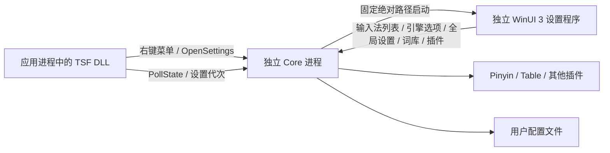

# Windows 输入法设置设计与实现

当前协议为 **v16**。设置程序为独立的 WinUI 3 应用（`Fcitx5Settings.exe`，C++/WinRT + XAML），最低支持 Windows 10 1809 x64（build 17763），通过用户/session 级 Named Pipe 与 Core 通信。Core 是所有配置的唯一写入者和运行时状态管理者。

## 当前方案

- **入口**：语言栏输入模式项的右键菜单在动态状态动作下方提供五项固定命令（“输入法设置”“用户数据文件夹”“重启服务”“关闭服务”“关于”）。
- **输入法列表与添加窗口**：默认列表为英文键盘和拼音。用户可添加已安装的输入法、删除（至少保留一个可用条目）并调整顺序。点击添加打开独立的选择窗口，左侧按本地化语言分组（`zh`/`zh_CN`/`zh_TW`/`zh_HK` 分别显示为“中文”“简体中文”“繁体中文”“中文（香港）”，空代码归入“其他”，未映射代码显示原代码），包含可添加非键盘输入法的语言排在前面，仅含键盘候选的语言排在后面；右侧列出尚未启用的可用条目。
- **可用输入法范围**：`base` 版包含拼音、双拼及八种 `fcitx5-chinese-addons` 码表（五笔字型、五笔拼音、仓颉、电报码、二笔、冰蟾、晚风、自然码）；`full` 版额外包含 Rime、温州话、注音及 `fcitx5-table-extra` 的 25 张码表；`windowskeyboard` 同时发布多语言键盘透传条目。
- **保存语义**：列表增删改序即时保存；引擎选项与全局设置修改在点击**应用**时保存且窗口保持打开。有未应用草稿时切换页面提示保存/放弃/取消，关闭窗口放弃未应用草稿。
- **全局设置与插件/词库页**：拼音页包含只读**词库**分页（热重载与目录见 [pinyin.md](pinyin.md#third-party-dictionaries)）；全局设置包含**常规**（UI 语言与候选框布局）、**开发者选项**、只读**插件**（不触发按需加载，见 [windows-plugins.md](windows-plugins.md)）和**快捷键**四个分页。UI 语言重启服务后生效，详见 [UI 国际化设计](windows-ui-localization-design.md)。

## 实现位置

- `win32/tsf/langbaritem.cpp`：实现 `ITfLangBarItemButton`，显示输入法图标/标签与名称，左键轮换，右键菜单与 `InitMenu`/`OnMenuSelect` 共享动态状态区和五项固定命令。
- `win32/tsf/aboutwindow.cpp`：原生非模态“关于”窗口，显示架构、CI 构建信息、commit 及项目/许可证链接。
- `win32/tsf/pollstate.cpp`、`servicecontrol.cpp`：TSF 消息调度、100 ms 状态轮询与后台服务/目录控制。
- `win32/ipc/protocol.h`、`inputmethodprotocol.h`、`statusmenuprotocol.h`：v16 协议 framing、输入法目录与语言元数据、引擎选项描述、全局语言/日志/快捷键/候选框布局、词库/插件查询、候选动作、状态菜单与宿主命令。
- `src/main.cpp`、`windowsinputmethods.cpp`：Core 初始化、拼音预热、内存输入法组建立、目录枚举、共享面板声明、配置校验与列表轮换。
- `src/windowssettings.cpp`、`windowsfrontend.cpp`：权威配置持久化、引擎配置应用与 context 同步。
- `src/windowsdictionaries.cpp`、`windowsplugins.cpp`：第三方词库目录扫描与重载、独立插件发现与只读 addon 状态查询。
- `win32/settings/SettingsWindow.cpp`：通过 `XamlReader` 构建界面并在后台线程执行 IPC。
- `win32/settings/keycapture.h`、`diagnostics.h`、`main.cpp`、`App.cpp`：快捷键录制、操作阶段、异常与进程退出诊断。
- `plugins/fcitx5-chinese-addons/im/pinyin/`：复用上游 `setUseShuangpin()`、`ShuangpinProfile`、`setConfig()` 与 `shuangpin.conf`（词库状态查询扩展记录在 `patches/chinese-addons-windows.patch`）。

## UI 框架与部署

| 方案 | 权衡 | 结论 |
| --- | --- | --- |
| WinUI 3 / Windows App SDK | 微软原生 Fluent UI，支持 XAML 缩放、主题与键盘导航；需独立运行时 | 已采用 |
| UWP XAML / WinUI 2 / XAML Islands | 需 NuGet 依赖且增加宿主窗口/线程/部署复杂度 | 未采用 |
| Win32 / Common Controls + DWM | 依赖轻，但现代外观与 DPI 布局维护成本高 | 备选 |
| WPF | 引入 .NET 运行时 | 未采用（项目为 C++） |

- Windows 10 上 `MicaBackdrop` 自动回退为主题纯色（见 [Mica 说明](https://learn.microsoft.com/en-us/windows/apps/design/style/mica)）。
- 采用 unpackaged + framework-dependent 文件夹部署：WinUI NuGet 固定为 `1.8.260803003`，运行时元数据固定为 `1.8.260921001`，要求当前用户已安装 x64 Windows App SDK 1.8 Framework/DDLM >= `8000.994.2142.0` 与 Visual C++ 运行库。启动时显式调用 bootstrap，缺少运行时报错提示，无需注册 MSIX。
- 独立 MSBuild `.vcxproj` 由 `scripts/build-settings.ps1` 构建，使用 `XamlReader` 动态加载 XAML（不依赖 UWP 工作负载）。安装包提供含/不含运行库两种变体，见 [安装器设计](windows-installer-design.md)。

## 进程与生命周期

- WinUI、XAML 与窗口消息循环位于独立进程，Settings 关闭或崩溃不影响应用中的 TSF 生命周期。
- Core 按自身安装树固定启动相邻 `settings/Fcitx5Settings.exe`，不搜索 PATH，不接收客户端传入路径；`OpenSettings` 回复确认启动/激活请求后立即返回，不阻塞 Core 事件循环。
- Settings 通过用户/session 级 named mutex/event 保证单实例，重复打开激活已有窗口；打开设置不改变当前输入法，也不将编辑器窗口作为模态 owner。
- 桌面 TSF 激活时在后台工作线程启动相邻 `bin/Fcitx5.exe`；重启服务会优雅停止并重启 Core（若 Settings 原本打开则在 Core 就绪后重开）；关闭服务优雅停止两者并在 `%LOCALAPPDATA%/fcitx5` 记录当前登录会话的手动停止状态（失败重试间隔 10 秒，超时报错，不按进程名强杀）。若 TSF 宿主正是 Settings 自身，由短暂的 `Fcitx5 --restart-services/--stop-services` 控制进程协调退出。
- 提权桌面 TSF 通过已运行的宿主 Core 执行设置、目录与服务命令，见 [UAC 方案](windows-uac-ipc-design.md)。

## 右键菜单与关于窗口

右键菜单顶部展示当前引擎的动态状态动作与子菜单（见 [状态菜单设计](windows-status-menu-design.md)），下方固定提供五项命令。桌面路径使用原生 `HMENU` / `TrackPopupMenuEx`，系统托管路径使用 `ITfMenu::InitMenu` / `OnMenuSelect`，选中后通过 dispatch window 交给后台任务执行，避免在菜单循环内执行 IPC。

- **语言栏按钮**：style 为 `TF_LBI_STYLE_BTN_MENU | TF_LBI_STYLE_BTN_TOGGLE | TF_LBI_STYLE_HIDDENSTATUSCONTROL`（不设 `TF_LBI_STYLE_TEXTCOLORICON` 以保留 PNG 图标原色）。左键轮换，右键开菜单，悬停提示显示当前输入法名称及子模式。
- **用户数据文件夹**：后台调用 `FOLDERID_RoamingAppData` 定位并创建/打开 `%APPDATA%/Fcitx5`（含 `config/fcitx5` 与 `pinyin` 用户数据），服务停止时依然可用。
- **关于窗口**：TSF 所属线程创建的原生非模态窗口，无需 Core、Settings 或 WinUI 运行库。展示 `Fcitx5 for Windows`、DLL 架构、CI 编号（本地构建显示本地编译说明）、commit/时间、可复制仓库 URL 及许可证/主页链接（Git SSH 自动转为 HTTPS，非 HTTP(S) 仅展示不启用按钮）。`win32/cmake/buildinfo.cmake` 在构建时生成元数据；窗口按自身 PMv2 DPI 缩放，重复打开激活已有窗口，停用/析构自动关闭。

## 设置窗口布局

默认尺寸 980 × 720 有效像素，最小跟踪尺寸 720 × 480，按窗口 DPI 换算物理像素。

| 区域 | 控件与行为 |
| --- | --- |
| 标题 | “输入法设置”，使用系统标题栏 |
| 输入法列表 | `ListView`：按用户顺序展示图标与名称，提供添加、删除、上移、下移 |
| 添加窗口 | 独立窗口，左侧按本地化 `language` 分组（有非键盘输入法优先），右侧显示未启用可用条目 |
| 全局设置 → 常规 | UI 语言下拉框（跟随系统、简体中文、繁體中文、English）与候选框布局下拉框（竖排、横排） |
| 全局设置 → 开发者选项 | 详细日志开关、当前状态、日志目录/文件数/总大小及打开目录按钮 |
| 全局设置 → 插件 | 只读 addon 名称、标识、版本、库、说明与状态，及个人插件目录按钮 |
| 全局设置 → 快捷键 | 轮换与直切第 1～5 项组合，支持多行编辑、录制与清空禁用 |
| 引擎设置页 | 按 `panel` 显示拼音/码表/键盘或通用页；拼音与双拼共用拼音页（全拼隐藏双拼专用项），码表按 entry 分别保存；通过 `Configuration::dumpDescription()` 递归生成开关、数值、枚举、文本/按键列表与模糊拼音子配置 |
| 双拼键位 | `ComboBox`：小鹤、自然码、微软、紫光、智能 ABC、中文之星、拼音加加、国标；保留已有 Custom 方案而不静默覆盖 |
| 拼音词库页 | 显示目录及加载中/已加载/失败/停用状态，可见时每 2 秒轮询 Core；提供打开目录按钮（离线可用） |
| 底部操作与状态 | **重置为默认值**（仅更新当前页草稿）、**关闭**、**应用**；展示加载中/保存中/连接失败（含**重试**）/保存失败/配置冲突 |

窗口启动后从 Core 读取实际配置，不在本地用默认值覆盖。采用原生键盘导航、Automation 属性、系统主题资源与 Per-Monitor DPI awareness。

## IPC 与配置所有权

v16 协议中以下全局消息强制 `contextId = 0`；`CycleInputMethod`、`SelectInputMethod`、候选动作和状态菜单校验 context 归属与焦点。AppContainer 输入入口仅开放输入、`GetGlobalSettings` 及限流的 `OpenSettings`。`KeyReply` 返回当前条目、子模式显示信息、详细日志状态、候选代次、候选框布局和状态菜单 revision。

| 请求 | 内容与回复 |
| --- | --- |
| `OpenSettings` | 无路径参数；返回启动/激活结果 |
| `GetGlobalSettings` / `SetGlobalSettings` | 查询/保存 UI 语言、`detailedLogging`、六项快捷键与 `candidateLayout`（共享独立 revision）；返回解析语言与 Core 当前语言 |
| `GetInputMethods` / `SetInputMethods` | 目录（含 `id`、`name`、`icon`、`iconLabel`、`panel`、`language`、`available`、`keyboard`）与有序列表；共享 revision，拒绝空列表与重复 ID |
| `GetMethodConfig` / `SetMethodConfig` | 读取引擎公开选项描述或提交 `path`/`value`，校验类型、范围、枚举、按键语法与 revision |
| `GetSettings` / `SetSettings` | 兼容旧拼音设置（`scheme`、`profile`、`revision`），`GB` 映射到上游 `GB Standard` 并回读验证 |
| `GetDictionaries` | 返回第三方词库目录及各词库路径与加载状态 |
| `GetPlugins` | 只读返回个人插件目录与已发现 addon 元数据/状态 |
| `OpenUserDataFolder` / `RestartServices` / `StopServices` | HostOnly / UAC 客户端请求宿主执行固定操作（空 payload） |

Settings 直接编译 `win32/tsf/pipeclient.cpp` 复用协议/传输头，通过 C++/WinRT `resume_background()` 在后台线程执行 I/O。保存超时不重放写请求，重连后先查询核对；重复提交已生效配置幂等成功。

## 引擎切换

1. Core 启动时枚举已安装可用条目，按 `windows.conf` 维护用户有序列表（独立于 Core 内部首个键盘槽位，允许用户移除英文键盘）。缺失引擎或数据时标为不可用。
2. 每个 TSF 实例记住当前条目并在焦点切换/重连后恢复；`GUID_COMPARTMENT_KEYBOARD_OPENCLOSE` 由当前条目是否为键盘推导，外部开关在已选键盘/非键盘条目间切换。
3. 引擎选项经 `getConfigForInputMethod` / `setConfigForInputMethod` 读写；scheme 或双拼键位变化时取消未提交预编辑。全局快捷键由 Core 在引擎处理前匹配，重复键与释放不二次触发。
4. `windowskeyboard` 发布多语言键盘透传条目，字符映射遵循当前 Windows 键盘布局，不切换系统布局或加载 XKB。

## 扩展约定

- 新插件无需增加专用 IPC 或 TSF profile：默认以 addon 名作为 `panel`（可通过 `inputmethod/*.conf` 的 `InputMethod/WindowsSettingsPanel` 和 `WindowsIconLabel` 覆盖），未知 panel 使用通用描述页渲染。
- `patches/chinese-addons-windows-table.patch` 在 Windows 启用仓颉并将内置码表路径解析到 `share/libime`。
- 引擎选项即时生效；UI 语言在重启服务后更新 Core/Settings，原生菜单与关于窗口后台刷新。
- **中英文标点**：在输入法状态菜单切换，由上游 `punctuation` 模块管理并保存到 `conf/punctuation.conf`（拼音、双拼及使用该模块的码表共享）。Settings 不提供重复选项；旧 `windows.conf` 中的 `Options/pinyin/WindowsPunctuation` 读取时忽略、下次保存时清除。保留上游“字母或数字后输入半角标点”规则。TSF 在非键盘输入法空闲时将 OEM 标点键与 Shift+数字送交 Core 决定转换与消费（不改变 Ctrl/Alt/Win 快捷键路由）。
  - 回归测试：`scripts/test-punctuation.ps1`（`FCITX5_UI_TEST` Core/TSF 与 `SKIP_FCITX_USER_PATH=1`）和 `scripts/test-settings-punctuation.ps1`（真实 Core + WinUI Settings，支持 `zh-Hans`/`zh-Hant`/`en`/`ja`）。

## 开发日志与全局选项

全局配置存储在 `conf/windows-ui.conf` **v4**，独立于 `windows.conf`。v1/v2 补齐默认快捷键，v1 默认关闭日志，v1–v3 默认竖排候选框，下次成功保存写入 v4。

- **候选框布局**：在**常规**分页切换竖排/横排，TSF 下一次收到 Core 状态回复即应用。
- **日志**：Core 默认记录 `Info` 级别引擎日志，开启详细日志后即时切到 `Debug` 并启用 Core/TSF/Settings 结构化 JSON Lines 日志（含 Settings 操作阶段、退出与异常诊断，致命路径尝试 250 ms 排空）。详见 [开发日志设计](windows-developer-logging-design.md)。
- 退出日志自动化：`scripts/test-settings-exit-logging.ps1`；开发者页 UI 自动化：`scripts/test-ui-localization.ps1 -TestLogging`。

## 快捷键录制

全局**快捷键**分页配置轮换键（默认 `Control+space`）与直切第 1～5 项（默认 `Control+Alt+1`～`Control+Alt+5`），按列表原始位置生效，目标不存在或不可用时透传。清空即禁用，重复或非法组合无法保存。

- 快捷键存储在 `windows-ui.conf` v4 的 `[Shortcuts]` 节（`0` 为轮换，`1`～`5` 为直切，多组合用分号分隔，每项最多 512 字节、16 个组合）。保存后 Core 即时生效，活动 TSF 在下一次配置轮询时更新缓存与 preserved keys。
- 共享解析与编码位于 `win32/ipc/shortcuts.h` 和 `portablekey.h`，支持修饰键、普通键、扫描码 `<scanCode>` 及 `F1`～`F24`。Win 键组合通过普通键回调路由。
- 全局快捷键与引擎 `KeyList` 均提供多行编辑和独立录制对话框：录制框聚焦时临时安装 `WH_KEYBOARD_LL` hook（仅前台生效，失焦/关闭即释放），区分左右修饰键且忽略自动重复/松键覆盖；确认后替换选区或追加一行，需点击**应用**保存。
- 验证：`test_keycapture`（单元测试）、`scripts/test-settings-keycapture.ps1`（合成按键录制）、`scripts/test-settings-shortcuts.ps1`（默认快捷键、编辑/校验、v2→v4 迁移及候选框布局切换）、`inputmethods_probe` 与 `tsf_probe --cycles`。

## 持久化与状态一致性

- `WindowsSettings` 将权威配置原子写入 `%APPDATA%/Fcitx5/config/fcitx5/conf/windows.conf` **v2**（含 scheme、profile、共享 revision、`InputMethods` 列表和 `Options`；v1 自动迁移）。上游 `conf/pinyin.conf` 和 `table/*.conf` 作为兼容镜像。
- 保存顺序：校验能力与 revision → 备份旧快照 → 通过 `atomicfile.h`（同目录临时文件 + `FlushFileBuffers` + `MoveFileExW`）原子写入 `windows.conf` → 更新引擎并回读验证 → 发布新 `settingsRevision` 并切换 context。存储失败在调用 addon 前返回，避免 libime 清空解码上下文；引擎应用失败则回滚配置并重置 context。
- `KeyReply::settingsRevision` 是独立的运行时代次，TSF 据此识别配置变更并在旧异步会话中保留 commit、清空旧 preedit/candidates。

## 验证与剩余范围

自动化覆盖：

- `test_langbar`、`test_protocol`、`test_settingsfile`、`test_keycapture`。
- `ipc_probe`、`settings_probe`（含 `--read-only-file`）、`tsf_probe`、`inputmethods_probe` / `scripts/test-inputmethods.ps1`。
- `scripts/test-settings-ui.ps1`（真实 Core + WinUI：增删改序、添加窗口、模糊拼音/双拼、词库页、重启恢复、单实例与截图）。
- 隔离 `-UiTest` Settings + `ui_fixture` 脚本：`test-ui-localization.ps1`、`test-settings-shortcuts.ps1`、`test-settings-keycapture.ps1`、`test-settings-plugins.ps1`、`test-settings-exit-logging.ps1`、`test-settings-punctuation.ps1`。

待实机验收：

- Windows 10 1809/22H2 与 Windows 11 的任务栏语言栏右键菜单、左键/快捷键轮换、图标/提示更新、单实例激活、记事本/浏览器/复杂应用实时生效。
- 其余内置双拼方案的实际选词验证，以及自定义双拼编辑与 ARM64 TSF 适配。
- 100%/150%/200% DPI 跨屏拖动、深浅色、高对比度、文本缩放、Explorer 重启、Core 断连及镜像不一致/崩溃故障恢复。
