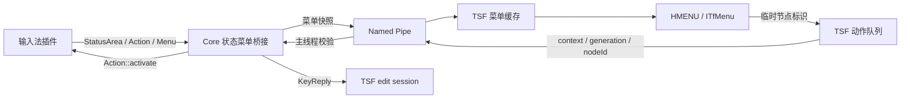

# Windows 输入法状态菜单与方案子菜单设计

## 状态与目标

Core、IPC 和 x64/x86 TSF 已接入通用状态菜单桥接，统一协议为 **v17**（消息类型自 v14 引入），Settings 使用同一协议头配套构建。桌面 `HMENU` 与系统托管 `ITfMenu` 共享冻结视图，Rime 和拼音的真实动作已由隔离 probe 覆盖；真实 Windows 语言栏派发、owner 焦点行为、DPI 和应用矩阵需系统验收。

桥接将上游 Fcitx `StatusArea → Action/Menu` 映射到 Windows 原生菜单：Rime 是首个验证插件，其他插件通过相同接口提供模式、标点、字符集、方案等动作，复用同一 Core/IPC/TSF 链路。

核心目标：

- 展示当前输入法提供的菜单文本、多级子菜单、分隔线和勾选状态。
- 在 Core 主线程调用插件动作，沿用 `KeyReply` 与 TSF edit session 更新预编辑、候选与提交。
- 拒绝来自旧焦点、旧连接、旧输入法或过期菜单快照的迟到选择。
- 桌面 `HMENU` 与系统托管 `ITfMenu` 共享同一数据模型，并保持现有权限隔离边界。

首版支持文本与状态菜单；菜单图标、插件自定义控件、Settings 内置方案编辑界面及 AppContainer 动态动作授权留待后续扩展。

## 架构与两种入口



以 Rime 为例，存在两条独立原生入口：

1. **F4 / Ctrl+反引号方案选单**：librime 生成候选，`fcitx5-rime` 转为 `CandidateList`，走既有按键/候选 UI 链路（`routesKey()` 已放行 F4 与 Ctrl+反引号，`keyFromWindows()` 已映射功能键与常用无 Unicode OEM 键）。
2. **语言栏方案子菜单**：插件发布 `Action/Menu`，通用桥接渲染为 Windows 菜单，点击直接调用原 `Action::activate()`（不合成按键，也不依赖 DBus）。

各层职责：

- **插件**：向 context 的 `StatusArea` 添加动作；文本与 `isChecked(ic)` 按传入 context 计算；状态变化调用 `Action::update(ic)` 或 `ic->updateUserInterface(StatusArea)`。Core 通用层不解析插件私有配置或按输入法名分支。
- **Core（`src/windowsstatusmenu.h/.cpp`、`src/windowsfrontend.*`）**：在主线程完成有界遍历、生命周期跟踪、快照代次管理与动作执行；读取 `BeforeInputMethod`、`InputMethod`、`AfterInputMethod` 三个状态组。
- **TSF（`win32/tsf/statusmenu.*`、`statusmenudispatch.cpp`、`langbaritem.*`）**：维护不可变冻结视图、单调命令 ID 与有界动作队列；选中后通过 `EditSession` 应用回复。

## 用户交互与显示规则

右键菜单顶部展示当前引擎状态菜单，底部保留五项固定命令（以 Rime 布局为例）：

```text
朙月拼音                     ▶
    西文模式
    ─────────────────
    ✓ 朙月拼音
      小鹤双拼
      五笔86
    ─────────────────
    重新部署
    同步用户数据
繁简转换                     ▶
─────────────────────────
输入法设置
用户数据文件夹
重启服务
关闭服务
关于
```

- 按 `BeforeInputMethod` → `InputMethod` → `AfterInputMethod` 顺序读取并在组间插入分隔线，自动清理首尾/连续分隔线并隐藏空子菜单；无动态项时直接展示固定命令。
- 子菜单父项仅展开，不直接激活；需要独立触发的插件应提供叶子动作。
- 左键与全局快捷键仍轮换用户输入法列表，不轮换插件内部方案。
- 每次打开菜单冻结一份视图；展开期间若后台内容变更，当前菜单保持原样，下次打开生效。
- 断连、无有效焦点或敏感 context 时不展示可执行动态区；首次缓存未就绪时显示禁用的加载提示并异步刷新。
- 插件文案按纯文本渲染：转义 `&`、移除换行/NUL/控制字符，`Action::hotkey()` 仅在快捷键列展示而不自动注册快捷键。

## Fcitx 抽象与 IPC 协议

| Fcitx 数据 | 协议表示 | 规则 |
| --- | --- | --- |
| `Action::shortText(ic)` | `label` | 插件本地化文字 |
| `Action::isSeparator()` | `Separator` | 仅展示，不入执行映射 |
| `Action::menu()` | `Submenu` + 子节点 | 父项不激活 |
| 已注册可达叶子动作 | `Command` + 临时 `nodeId` | 回到原 context 执行 |
| `isCheckable()` / `isChecked(ic)` | `checkable` / `checked` | 按 context 读取（统一用勾选标记） |
| `Action::hotkey()` | `shortcutText` | 仅展示 |

固定版本上游 `Action` 无通用 `isEnabled(ic)`/`isVisible(ic)` 接口；协议 `enabled` 表示桥接可执行性（未注册叶子、无效快照或本地加载提示为禁用）。同一动作允许出现在多个合法路径，循环检测基于当前递归路径，避免误删共享子菜单。

### IPC 消息与数据结构

消息类型：`GetStatusMenu = 42`、`StatusMenuReply = 43`、`ActivateStatusMenu = 44`、`StatusMenuActionReply = 45`。两者均为 context 请求，校验连接归属、Core 当前焦点与输入策略。

```cpp
enum class StatusMenuNodeKind : uint8_t { Command, Submenu, Separator };
enum class StatusMenuError : uint8_t {
    None, Unavailable, Stale, Invalid, Busy, Failed
};

struct StatusMenuNode {
    uint32_t nodeId;
    uint32_t parentId; // 0 为根，其余引用更早的 Submenu
    StatusMenuNodeKind kind;
    bool enabled;
    bool checkable;
    bool checked;
    std::string label;
    std::string shortcutText;
};

struct StatusMenuReply {
    StatusMenuError error;
    uint64_t revision;   // 对应 KeyReply::statusMenuRevision
    uint64_t generation; // 有动态节点时非零；空菜单或错误为 0
    std::string inputMethod;
    std::vector<StatusMenuNode> nodes;
};
```

- **额度与校验**：最多 256 节点、4 层（根项为第 1 层）、单项文字 1024 字节、快捷键 256 字节、总回复不超过 64 KiB。超额、成环、非法结构或无效 UTF-8 返回 `Failed` 并清除快照（不截断菜单）。
- **缓存与限频**：Core 仅为当前焦点保留 1 份可执行快照（切焦点即释放，满足每连接最多 4 份 / 256 KiB 上限）；每 context 查询限频 500 ms，超频返回 `Busy`。重复查询若焦点、revision、对象身份和规范化内容未变，则复用原 `generation`。
- **与 `KeyReply` 联动**：`KeyReply::statusMenuRevision` 通知 TSF 刷新缓存，普通 poll 不使菜单失效；成功空菜单记为有效缓存，避免反复显示加载中。

## 身份校验、缓存与 Windows 渲染

### Core 身份与状态观察

- 执行映射绑定连接身份、context ID 与焦点代次、输入法 ID、状态 revision、快照 `generation`、菜单路径及桥接分配的单调对象生命周期标识（并监听 `ObjectDestroyed`、`Action::Update`、`Menu::Update`、`InputContextUpdateUIEvent(StatusArea)` 与 `InputContextFlushUIEvent(StatusArea)`）。
- 即使新动作复用相同名称、action ID 或内存地址，旧节点也不会重新绑定。执行前重新遍历可达路径与注册表核对身份，执行前即将该快照标为已使用（防重复激活）。序列化期间若状态变化则最多重试一次，仍不稳定返回 `Busy`。

### TSF 缓存与渲染

- `OnClick`、`InitMenu`、`OnMenuSelect` 不执行同步 Pipe I/O 或文档编辑，统一经 dispatch window 异步刷新缓存并将选择入队（每实例最多排队 8 个动作，同视图最多执行 1 个）。
- 每次新建菜单视图分配单调递增的动态 Windows `UINT` 命令 ID（不回收，32 位耗尽则停用动态区直至重新激活），杜绝旧 `OnMenuSelect` 误触发新视图条目。
- **桌面 `HMENU`**：在 `langbaritem.cpp` 中优先使用当前同线程/同进程的前台窗口作为 owner；否则创建不激活的 `WS_EX_TOOLWINDOW | WS_EX_NOACTIVATE` 辅助窗口作为 owner（不调用 `SetForegroundWindow`）。经 `AuxiliaryUI` 协商许可后以 `TrackPopupMenuEx(TPM_RETURNCMD | TPM_NONOTIFY | TPM_RIGHTBUTTON)` 显示，退出后立即按冻结视图转交动作并释放菜单资源。若期间发生真实 FocusOut，动态动作自动作废。
- **系统托管 `ITfMenu`**：`InitMenu` 递归映射到 `ITfMenu::AddMenuItem`（`TF_LBMENUF_SUBMENU` / `SEPARATOR` / `CHECKED` / `GRAYED`），`OnMenuSelect` 校验本地身份后入队。

### 动作执行与输入语义

TSF 出队复核焦点/连接代次后发送 `ActivateStatusMenu` → Core 主线程校验并调用 `Action::activate(originalContext)` → 通用层不统一调用 `reset()` 或丢弃 `takeCommit()`，由插件决定清空预编辑、重算候选或提交文本 → Core 返回含最新 `KeyReply` 的 `StatusMenuActionReply` → TSF 经 `EditSession` 应用到原 context。超时/断线不重放，重连后同步真实状态。

## Rime 接入与环境权限

Rime 适配保存在 `patches/fcitx5-rime-windows.patch`：

- 方案动作通过 `isChecked(ic)` 查询当前 context 的 Rime session，按 context 区分勾选状态；西文模式等选项动作同样映射真实状态。
- 方案切换先确认目标可用且非维护中，取消旧 composition 与候选后调用 `select_schema()`，立即同步刷新预编辑、候选、子模式与状态菜单。
- 部署开始时撤销方案动作并展示维护提示，完成后重建动作（部署异步执行）。用户配置位于 `%APPDATA%/fcitx5/rime`，运行时方案由 librime 管理，不重复写入 `windows.conf`。
- `KeyReply` 携带通用 `inputMethodSubMode` 与 `inputMethodSubModeLabel`，语言栏提示展示“输入法 · 子模式”，Rime 西文模式保持在 Rime 条目内而非切换 Windows 英文键盘。

环境权限边界：

| 环境 | 动态状态菜单 | 固定服务命令 |
| --- | --- | --- |
| 普通桌面 TSF | 有有效焦点 context 时可用 | 沿用桌面策略 |
| 提权桌面 TSF | 经 UAC 身份校验由宿主 Core 执行 | 经已运行宿主 Core 路由 |
| Sandboxie 桌面管理入口 | 经宿主策略由宿主 Core 执行 | 经宿主 Core 路由 |
| AppContainer / 受限 `-input` 入口 | 拒绝 `GetStatusMenu` / `ActivateStatusMenu` | 仅保留 Settings |
| secure、COM-less、密码、只读、禁用 context | 不查询、不执行 | 沿用现有策略 |

## 故障处理与隐私

无动作时返回空菜单；首次未就绪显示加载提示；超额/非法树清除执行映射并显示读取失败；快照/焦点变更返回 `Stale` 拒绝执行；异常刷新真实状态。诊断日志仅记录连接/context ID、代次、节点数、层数、耗时、状态码与 HRESULT，不记录节点文字、schema ID、动作名、输入文本或用户路径（详见 [开发日志设计](windows-developer-logging-design.md)）。

## 实现分布

| 文件 | 职责 |
| --- | --- |
| `src/windowsstatusmenu.h/.cpp` | Core 通用遍历、生命周期、revision、快照与动作调用 |
| `src/windowsfrontend.*`、`src/windowsinputmethods.cpp` | 消息路由、焦点/owner 校验、子模式名称与标签 |
| `win32/ipc/statusmenuprotocol.h`、`protocol.h`、`isolationpolicy.h` | v17 数据模型、有界编解码与受限入口拒绝策略 |
| `win32/tsf/statusmenu.h/.cpp`、`statusmenudispatch.cpp`、`pipeclient.*` | 冻结视图、命令 ID、动作队列与 Pipe 请求 |
| `win32/tsf/langbaritem.*`、`tsf.h`、`pollstate.cpp`、`EditSession.cpp` | `HMENU` / `ITfMenu` 渲染、缓存刷新、焦点/停用清理与回复应用 |
| `patches/fcitx5-rime-windows.patch` | Rime 方案勾选、切换取消与 UI 刷新 |
| `win32/settings/`、`win32/tests/ui_fixture.cpp`、`po/` | 协议消费者、模拟 Core 与提示翻译 |

## 自动化覆盖与待验收矩阵

### 已覆盖的自动化验证

- **根工程单元测试**：开启 `-DENABLE_WINDOWS_STATUS_MENU_TESTS=ON` 运行 `test_windowsstatusmenu`（多级菜单、多 context 勾选、状态组、共享子菜单、未注册叶子、循环图、对象销毁与 ID/地址复用、异常与额度边界）。
- **TSF 默认 CTest**：`test_protocol`、`test_statusmenu`、`test_langbar`、`test_isolationpolicy`、`test_candidate_tsf`（编解码校验、冻结视图、动态 ID 不复用、`ITfMenu` 渲染、迟到选择与焦点切换隔离）。
- **真实引擎隔离集成**：`scripts/test-status-menu.ps1 -Rime`（使用 `FCITX5_UI_TEST` 构建与独立 `FCITX5_TEST_USER_ROOT`）驱动 `statusmenu_probe`，覆盖临时目录内 Rime 首次部署（`luna_pinyin` / `luna_pinyin_simp`）、F4/Ctrl+反引号候选选单、方案勾选/切换、繁简提交、旧预编辑取消、重新部署恢复、拼音真实动作、跨连接/旧焦点拒绝与重复动作拒绝；`-PeerTsfBuild` 增加跨架构并发 Pipe 校验（命令见 [build.md](build.md#status-menus)）。

### 待补充覆盖与系统验收

- 自动化待补：`InputState` 共享/独立策略、不可用方案、部署失败与中断恢复。
- 真实系统验收矩阵：

| 场景 | 验收要点 |
| --- | --- |
| Windows 10/11 输入指示器与浮动语言栏 | 实际回调、嵌套菜单、勾选、键盘导航及 owner 焦点行为 |
| 记事本、浏览器与复杂文本应用 | Rime/拼音菜单切换、无意外提交、切焦点拒绝旧选择 |
| 系统托管现代桌面宿主 | `ITfMenu` 层级、编辑结果与无擅自自绘回退 |
| AppContainer / Sandboxie / UAC | 各入口权限、宿主路由与受限入口拒绝动作 |
| x86 / x64 混合与 DPI / 主题 / 无障碍 | 双架构一致、100%–200% 跨屏/负坐标、高对比度与屏幕阅读器 |
| 生命周期 | Core 重启、手动停止、菜单打开时断线、重新部署与宿主退出 |

## 参考

- 本仓库固定版本：[Action](../fcitx5/src/lib/fcitx/action.h)、[Menu](../fcitx5/src/lib/fcitx/menu.h)、[StatusArea](../fcitx5/src/lib/fcitx/statusarea.h)、[UserInterfaceManager](../fcitx5/src/lib/fcitx/userinterfacemanager.cpp)
- Rime 插件：[rimeengine.cpp](../plugins/fcitx5-rime/src/rimeengine.cpp)、[rimestate.cpp](../plugins/fcitx5-rime/src/rimestate.cpp)
- Win32 / TSF API：[ITfMenu::AddMenuItem](https://learn.microsoft.com/en-us/windows/win32/api/ctfutb/nf-ctfutb-itfmenu-addmenuitem)、[OnMenuSelect](https://learn.microsoft.com/en-us/windows/win32/api/ctfutb/nf-ctfutb-itflangbaritembutton-onmenuselect)、[TrackPopupMenuEx](https://learn.microsoft.com/en-us/windows/win32/api/winuser/nf-winuser-trackpopupmenuex)
