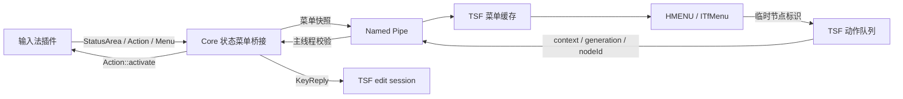

# Windows 输入法状态菜单与方案子菜单设计

## 状态与目标

Core、IPC 和 x64/x86 TSF 已接入通用状态菜单桥接，统一协议为 v13；Settings 使用同一协议头配套构建。桌面 `HMENU` 与系统托管 `ITfMenu` 使用冻结视图，Rime 和拼音的真实动作已有隔离 probe。真实 Windows 语言栏派发、辅助 owner 焦点行为、DPI 和应用矩阵仍需系统验收。

采用 Fcitx `StatusArea → Action/Menu` 到 Windows 原生菜单的通用桥接。Rime 是首个验证对象；其他插件通过相同接口提供模式、字符集、方案或其他状态动作，复用同一条 Core、IPC 和 TSF 路径。

目标包括：

- 显示当前输入法提供的菜单文字、子菜单、分隔线和勾选状态。
- 在 Core 主线程调用插件动作，沿用输入状态快照和 TSF edit session 更新预编辑、候选及提交。
- 拒绝来自旧焦点、旧连接、旧输入法和已重建菜单的迟到选择。
- 桌面弹出菜单与系统托管 `ITfMenu` 使用相同数据模型。
- 保持现有 Settings、服务控制和受限输入入口的权限边界。

首版包含文本和状态菜单。菜单图标、插件自定义控件、任意命令执行协议、Settings 中的方案安装/编辑界面，以及 AppContainer 动态动作授权另行设计。

## 当前实现与两种菜单入口

| 位置 | 当前行为 | 本设计中的作用 |
| --- | --- | --- |
| `plugins/fcitx5-rime/src/rimeengine.cpp` | `updateSchemaMenu()` 通过 librime 枚举方案，创建 `Action/Menu`，放入 context 的 `StatusArea`；另有部署、同步及方案选项动作 | 首个真实插件适配 |
| `plugins/fcitx5-rime/src/rimestate.cpp` | `selectSchema()` 调用 librime，`keyEvent()` 将引擎输出转为预编辑和候选 | 保留方案和输入语义 |
| `fcitx5/src/lib/fcitx/action.h`、`menu.h`、`statusarea.h` | 提供动作、菜单树、勾选及更新通知 | 通用菜单来源 |
| `src/windowsfrontend.*` | 主线程处理 context IPC，序列化输入状态和候选动作 | 增加状态菜单桥接 |
| `win32/tsf/langbaritem.*` | 固定右键菜单，桌面使用 `HMENU`，系统托管路径使用 `ITfMenu` | 增加动态区域 |
| `win32/tsf/EditSession.cpp` | 绑定 context 和代次应用 Core 回复 | 复用编辑边界 |
| `src/windowsinputmethods.cpp` | 将输入法名称和图标等加入 `KeyReply` | 增加通用子模式显示 |

Rime 有两个独立入口：

1. **F4 方案选单**：librime 生成候选，fcitx5-rime 转为 `CandidateList`，现有 IPC 和候选 UI 负责显示。优先补通 TSF 按键路由与 Core 键码映射，再验证选择和翻页。
2. **语言栏方案子菜单**：插件生成 Fcitx `Action/Menu`，本设计将其转换为 Windows 菜单。点击触发原动作，不合成 F4 或选词按键。

`routesKey()` 已允许 F4 和 Ctrl+反引号，`keyFromWindows()` 已补齐功能键和常用无 Unicode 的 OEM 键映射，其他 Ctrl 组合键继续沿用原路由策略。快捷键由引擎决定是否消费；`Action::hotkey()` 只用于显示，不会自动注册快捷键。

## 用户交互

右键菜单顶部展示当前输入法状态，底部保留现有固定命令。以 Rime 为例，以下文字和方案仅作布局示意，实际内容由插件提供：

```text
朙月拼音                     ▶
    西文模式
    ─────────────────
    ✓ 朙月拼音
      小鹤双拼
      五笔86
    ─────────────────
    重新部署
    同步用户数据
繁简转换                     ▶
─────────────────────────
输入法设置
用户数据文件夹
重启服务
关闭服务
关于
```

显示规则：

- 保留插件定义的顺序与层级；按 `BeforeInputMethod`、`InputMethod`、`AfterInputMethod` 顺序读取状态组，组间按需插入分隔线。
- 清理首尾及连续分隔线，隐藏空子菜单。没有动态项时直接显示原有固定菜单。
- 子菜单父项只负责展开。上游动作同时有 `menu()` 和 `activate()` 时，本入口只暴露展开行为；需要独立点击功能的插件应提供叶子动作。
- 左键及 Windows 全局快捷键继续轮换用户输入法列表，不用于轮换 Rime 内部方案。
- 每次打开冻结一份菜单视图。展开期间内容变化，不原地替换条目或命令映射；下一次打开使用新视图。
- 断连、无有效输入 context 或敏感 context 时不提供可执行的动态区域；固定命令继续遵守已有环境策略。
- 首次缓存尚未就绪时，显示禁用的“正在读取输入法菜单…”并请求刷新；本次菜单保持原样，重新打开后使用结果。查询失败时可重开重试，不自动重新弹出菜单。

方案名称、选项文字和勾选状态由 Core 中的插件提供。Windows 固定命令及加载/失败提示使用现有 gettext 翻译。插件文字按纯文本显示，转义 Windows 菜单中的 `&`，移除换行、NUL 和控制字符；快捷键单独放在显示列，不把插件文字解释为助记键或命令。

## 架构与职责



### 插件

插件注册动作并添加到实际 context 的 `StatusArea`。叶子动作负责业务执行；菜单文字和 `isChecked(ic)` 根据传入 context 返回当前状态。状态变化时调用 `Action::update(ic)` 或 `ic->updateUserInterface(StatusArea)`；结构变化使用 `Menu` 的添加/移除接口。

Core 通用层不解析 `schema_id`、Rime YAML、插件私有配置或数据库，也不按输入法名称分支。Windows TSF 与 Settings 不链接插件或 librime。没有状态菜单的插件无需适配。

### Core

`src/windowsstatusmenu.h/.cpp` 负责有界遍历、状态序列化、对象生命周期跟踪、快照代次和动作激活。对象访问、信号连接与执行全部位于 Core 主事件循环。Pipe 线程继续通过 `EventDispatcher` 投递请求。

桥接读取当前 context 的三个状态组，捕获实际可达的动作。全局 `UserInterfaceManager` 注册表只作身份核对，不作为可执行动作目录。

### TSF

`win32/tsf/statusmenu.h/.cpp` 和 `statusmenudispatch.cpp` 管理不可变视图、命令 ID、失效状态和有界队列。`LangBarItem` 只渲染并转交选择；`Tsf` 负责 context 校验、IPC 及回复的编辑调度。

### Settings

Settings 继续承担持久配置和输入法列表管理。运行时方案选择属于原输入 context，首版不在 Settings 中增加“当前焦点方案”操作，也不把菜单树加入 `GetMethodConfig`。

## Fcitx 抽象的适配边界

| Fcitx 数据 | 协议表示 | 规则 |
| --- | --- | --- |
| `Action::shortText(ic)` | `label` | 插件本地化后的显示文字 |
| `Action::isSeparator()` | `Separator` | 无执行标识 |
| `Action::menu()` | `Submenu` 和子节点 | 父项不激活 |
| 注册且可达的叶子动作 | `Command` 和临时 `nodeId` | 点击回到原 context 执行 |
| `isCheckable()`、`isChecked(ic)` | `checkable`、`checked` | 每个 context 单独读取 |
| `Action::hotkey()` | `shortcutText` | 只展示，不触发注册 |
| `Action::icon()`、`longText()` | 首版不传输 | 后续按实际需求扩展 |

固定版本上游 `Action` 没有通用 `isEnabled(ic)` 或 `isVisible(ic)` 接口。协议中的 `enabled` 由桥接可用性决定，例如未注册的叶子动作、无效快照或本地加载提示；不能声称可以直接读取插件禁用状态。插件临时不可操作时应移除相应动作，或在回调中检查自身状态；需要展示禁用原因时再设计明确的通用扩展。

上游只有“可勾选”属性，没有互斥组声明。首版统一使用勾选标记；Rime 保证只有当前方案被勾选，Windows 不根据文字或位置推断单选组。

未注册的叶子动作显示为禁用，不进入执行映射；分隔线和纯子菜单容器无需注册。相同动作允许出现在多个合法路径，每个出现位置分配独立节点标识。循环检查使用当前递归路径，不能用全局去重错误地删除共享子菜单。

## IPC 设计

### 消息

v13 分配 `GetStatusMenu=42`、`StatusMenuReply=43`、`ActivateStatusMenu=44` 和 `StatusMenuActionReply=45`：

| 消息 | contextId | payload / reply |
| --- | --- | --- |
| `GetStatusMenu` | 原输入 context | 空 payload；返回 `StatusMenuReply` |
| `StatusMenuReply` | 同请求 | 状态、菜单代次、当前输入法标识及节点列表 |
| `ActivateStatusMenu` | 原输入 context | `generation:u64`、`nodeId:u32` |
| `StatusMenuActionReply` | 同请求 | 结果；成功接受动作时附带最新 `KeyReply` |

这两类请求属于 context 请求，使用现有 owner 校验，不加入 `globalSettingsRequest()`。查询和执行都要求 context 存在、属于当前连接、仍有焦点且允许输入。对焦点已切换到其他 context 的情况，结合 Core 当前焦点身份拒绝旧请求；不能仅检查 context 曾经 focus-in。

数据结构：

```cpp
enum class StatusMenuNodeKind : uint8_t { Command, Submenu, Separator };
enum class StatusMenuError : uint8_t {
    None, Unavailable, Stale, Invalid, Busy, Failed
};

struct StatusMenuNode {
    uint32_t nodeId;
    uint32_t parentId; // 0 表示根；其余必须引用更早的 Submenu
    StatusMenuNodeKind kind;
    bool enabled;
    bool checkable;
    bool checked;
    std::string label;
    std::string shortcutText;
};

struct StatusMenuReply {
    StatusMenuError error;
    uint64_t revision;   // 对应 KeyReply::statusMenuRevision
    uint64_t generation;
    std::string inputMethod;
    std::vector<StatusMenuNode> nodes;
};
```

采用父节点先出现的扁平节点列表，通过已有 `Reader/Writer` 编解码。整数使用既有协议字节序和定宽类型；布尔值校验为 0/1，枚举校验范围。协议不传对象地址、Fcitx action ID、回调、HWND、文件路径或 shell 命令。

`nodeId` 在同一快照内非零且唯一，分隔线也有展示节点 ID，但不进入执行映射。`generation` 在成功且包含动态节点的回复中非零；空菜单和错误回复为 0。只有 `enabled` 的 `Command` 可激活。

### 额度与解析

首版固定额度：最多 256 个节点、4 层菜单（根项为第 1 层）、单项文字 1024 字节、快捷键文字 256 字节，整个动态菜单回复不超过 64 KiB。Core 在复制和遍历过程中逐步核算，TSF 解码时再次校验。

超出额度、图有环、结构非法或输出不是合法 UTF-8 时，返回 `Failed` 并清除对应执行快照，不截断成可能改变动作含义的菜单。前后及连续分隔线的清理属于正常规范化。拒绝重复 ID、缺失父项、父项不是子菜单、非法状态组合、未知字段值和尾随字节。

每个 context 最多保留一个当前可执行快照。当前实现只为 Core 的当前焦点保留快照，焦点切换释放上一份缓存，满足每连接最多 4 份、256 KiB 的上限；释放后旧代次返回 `Stale`。观察连接和执行映射随缓存释放。请求在所属连接内串行处理，查询限频为每 context 500 ms 一次；超频返回 `Busy`，不产生额外任务积压。

### 与输入状态的关联

`KeyReply` 增加 `statusMenuRevision:u64`，作为缓存刷新提示，不替代动作请求中的菜单代次。普通 poll 不生成新菜单、不消费提交，也不因为 `KeyReply::revision` 自增就使菜单失效。

`statusMenuRevision` 在状态菜单内容、动作语义或拓扑需要更新时改变。TSF 发现变化后请求菜单；当前输入法切换、焦点清理或断线则立即清除缓存。菜单代次在有界序列化成功后产生，绑定该次状态 revision。

重复查询时，若焦点、状态 revision、对象身份及规范化菜单内容均未改变，复用原快照与 `generation`，避免后台查询使已展开菜单无故失效。菜单回复带自身 `revision`，TSF 不用请求发出时的旧状态替代它。首次焦点建立即安排查询；成功的空菜单也记为有效缓存，避免将 `generation == 0` 误判为持续未加载。

菜单 revision 和快照代次使用 Core 分配的非零单调计数，连接及焦点身份另行校验；溢出时使菜单功能失效，重启 Core 并重连后恢复，不回绕复用。

`StatusMenuActionReply` 的 `None` 表示已通过校验并调用插件动作。上游 `Action::activate()` 返回 `void`，因此通用层不能把它解释为业务必然成功；实际结果由回复及后续 poll 的输入状态体现。异步部署可先接受请求，随后再更新状态。执行抛异常返回 `Failed`、使快照失效，并通过后续 poll 获取真实状态；不承诺回滚插件的部分副作用。

## 菜单身份与失效

### Core 身份

执行映射绑定以下数据：

- Pipe 连接身份、context ID 与其焦点代次。
- 当前输入法唯一标识、菜单状态 revision 和快照 `generation`。
- 节点在菜单中的路径、桥接分配的对象生命周期标识及注册状态。

`Action::id()` 会被回收，名称及内存地址也可能重复使用。桥接在首次观察对象时分配单调递增的生命周期标识，并持有 `ObjectDestroyed` 连接；销毁立即将映射标记为不可执行。`Menu` 同样跟踪生命周期和 `Update`。即使新动作获得相同名称、action ID 和地址，旧节点也不能重新绑定。

执行前在 Core 主线程重新从原 context 的状态树确认路径及对象身份，并检查叶子动作仍已注册、注册表仍指向该对象、节点仍可执行。缓存中的裸指针只有在生命周期守卫有效后才能访问。执行期间不保留容器元素引用，插件回调可能重建菜单或销毁自身动作。

### 状态观察

监听 `InputContextUpdateUIEvent(StatusArea)`、`InputContextFlushUIEvent(StatusArea)`、已观察的 `Action::Update`、`Menu::Update` 和对象销毁。状态树修改在请求 UI 更新时立即撤销旧执行代次，对应的后续批量 flush 合并为同一次更新。与指定 context 有关的更新将缓存标记为 dirty；`InputPanel` 的普通候选更新不使状态菜单失效。

插件有不改变显示文字的语义变化时，也必须发出状态更新。序列化期间记录状态 revision，遍历前后不一致时放弃结果，合并安排下一次读取；最多一次当前请求内重试，仍不稳定返回 `Busy`。getter 应是有界的状态查询，不进行部署、磁盘扫描或网络访问。

Core 每次生成快照和执行前都会重新检查可达结构与显示状态，用于发现缺少通知的可观察变化；这不能识别插件未报告的隐藏语义变化，插件接口约定和测试必须覆盖这一点。

### TSF 身份

TSF 保存原 `ITfContext`、本地 `generation_`、远程 context ID、连接代次以及菜单快照身份。选择先捕获这些数据再入队；出队请求前、接收回复后和进入 edit session 时分别复核。

| 事件 | Core 行为 | TSF 行为 |
| --- | --- | --- |
| 普通 poll、候选游标移动 | 保留未变化的菜单身份 | 保留缓存 |
| 插件状态通知、菜单变化或对象销毁 | 使旧代次失效 | 请求刷新；已展开视图保持冻结 |
| 当前输入法变化 | 清除原快照 | 清缓存并关闭自有弹出菜单 |
| FocusOut、context 销毁或焦点换到其他 context | 使旧焦点快照失效 | 关闭自有菜单、清队列和缓存 |
| 断线、Core 重启、TSF 停用 | 清除连接下全部映射 | 清缓存，拒绝迟到回调和回复 |
| 成功接受一个动作 | 在调用前使该快照不可再次执行 | 等待回复和刷新，不自动重发 |
| 桌面菜单取消 | 不激活动作 | 释放冻结视图，恢复正常刷新 |

展开期间出现状态变化后，用户仍可能看到旧菜单，选择会返回 `Stale`。TSF 关闭菜单并刷新下次视图，不把同一节点号套用到新菜单，也不自动执行“同名项”。

## 查询缓存与菜单重入

`OnClick`、`InitMenu` 和 `OnMenuSelect` 不同步访问 Pipe。沿用 owning-thread 消息调度，在焦点建立、菜单 revision 改变以及打开菜单发现缓存缺失时安排 `GetStatusMenu`，刷新任务按 context 合并。

同一 TSF 实例对现有 `PipeClient` 保持串行访问。首版通过 dispatch window 在菜单回调之外执行有时限的查询，不将该客户端同时交给工作线程。若真实宿主测试发现查询延迟影响输入，再独立设计串行异步传输；不能绕过连接归属规则，临时换一条连接操作已有 context。

菜单回调可能经 COM 或菜单消息循环重入。开始构建时先捕获不可变视图和命令映射；回调期间不修改正在使用的映射。所有持久状态先更新再通知外部 COM，停用时先标记失效再释放对象。

新菜单视图使用新的 Windows `UINT` 命令 ID，不能复用前一个视图的动态 ID 来解释迟到的 `OnMenuSelect`。固定命令继续保留现有 ID；动态 ID 从独立范围单调分配，每个 `LangBarItem` 生命周期内不回收。32 位 ID 空间耗尽时停用动态区域直到重新激活，不回绕。

每个动态 ID 映射到创建时的视图、菜单代次和节点号。只接受最近一次构建的有效视图；下一次 `InitMenu`、焦点失效或停用后，旧动态 ID 一律拒绝。每个 TSF 实例最多排队 8 个菜单动作，同一视图只允许一个动作进入执行。

## Windows 渲染

### 桌面 HMENU

从冻结视图构造 `HMENU`，使用系统子菜单、勾选和禁用样式。沿用 `AuxiliaryUI` 与 `BeginUIElement` 协商，宿主拒绝显示时不自行绕过。所有菜单和 COM 资源由 RAII 管理，失败路径释放已创建的子菜单与辅助窗口。

`TrackPopupMenuEx` 使用返回命令 ID 的模式。菜单退出后先把选择转换为包含完整身份的队列记录，再释放该视图。固定命令与动态命令按独立映射派发，不将服务器节点号直接作为 Windows 命令 ID。

菜单锚点采用 TSF 回调提供的屏幕位置，保持线程 DPI awareness 的进入/恢复规则，不改变宿主进程设置。字号、键盘导航、勾选、高对比度和基础无障碍交给系统菜单。

动态动作必须保留原输入 context。现有桌面路径会创建辅助 owner 并调用 `SetForegroundWindow`，实施时必须专门检查它是否触发 TSF 的 context 清理。优先使用合法的宿主 owner；确需辅助窗口时保持不激活，并验证菜单取消行为。若系统报告实际失焦，立即作废本次动态动作；不能为了让菜单工作而忽略真实 FocusOut 或将操作迁移到新焦点。该项是桌面路径上线的验收条件。

### 系统托管 ITfMenu

`InitMenu` 将同一冻结视图递归映射到 `ITfMenu::AddMenuItem`，使用 `TF_LBMENUF_SUBMENU`、`TF_LBMENUF_SEPARATOR`、`TF_LBMENUF_CHECKED` 和 `TF_LBMENUF_GRAYED`。子菜单输出指针在调用前置空，并可靠释放接口；部分构建失败返回对应 HRESULT。

`OnMenuSelect` 只查映射、校验本地身份并投递消息，不执行 IPC、插件调用或文档编辑。宿主托管菜单没有本地 `HMENU` 可关闭时，通过映射失效拒绝迟到操作，下次 `InitMenu` 使用新视图。

immersive/UIElement-only 宿主使用此路径，保持现有辅助 UI 权限。真实系统宿主是否支持全部层级和勾选表现需要实测；不支持时保留固定命令和 F4 候选入口，不悄悄展开为不同含义的可执行列表。

## 动作执行与输入语义

执行流程：

1. TSF 从冻结视图捕获完整身份，将操作放入 owning-thread 队列。
2. 出队时复核 context、连接代次、前台状态和输入策略，发送 `ActivateStatusMenu`。
3. Core 检查连接归属、当前焦点、输入法、快照、对象生命周期、可达路径和叶子能力。
4. 校验通过后先将快照标为已使用，再调用 `Action::activate(originalContext)`；回调前复制必要标量，避免动作销毁导致悬空引用。
5. 重新读取输入状态，构造 `StatusMenuActionReply`，其中包含最新 `KeyReply`；后续异步变化由既有 poll 获取。
6. TSF 复核原始身份，通过 `submitSnapshot()` 及正确的 edit session 应用预编辑、候选和提交，更新语言栏并刷新菜单缓存。

通用桥接不统一调用 `reset()`，也不统一丢弃 `takeCommit()`。不同动作可能有“切换方案并清空预编辑”“切换繁简并重算候选”或“提交当前选择”等不同语义，必须由插件决定。通用层只传递插件产生的真实结果，菜单文字绝不作为提交文本。

请求超时或断线后不重放动作。Core 可能已经执行而回复未到达，TSF 在重连后查询真实状态。快照的一次使用限制防止同一有效视图被重复激活，但不提供跨进程 exactly-once；新视图中的再次点击是新的用户请求。

## Rime 首次接入

Rime 调整记录在主仓库 `patches/fcitx5-rime-windows.patch`，按固定子模块版本应用，不升级或创建子模块提交。

已接入的行为：

- 方案动作通过 `isChecked(ic)` 查询对应 Rime session 的当前 schema；勾选值按 context 计算，不能用共享 `SimpleAction::setChecked()` 保存所有 context 的结果。
- 将西文模式及需要勾选的选项动作映射为真实状态；通用层不识别这些动作名称。
- 方案切换先确认目标仍可用及当前不处于维护状态，然后取消旧 composition、清空旧候选，再调用 `select_schema()`；失败后重读实际 schema 和 UI，不提交旧方案预览文本。
- 切换后同步刷新预编辑、候选、子模式及状态菜单；不能只依赖延后的 schema 通知来清除旧候选。
- 部署开始即撤销当前方案/选项动作，展示不可执行的维护状态；部署完成重建动作，失败后保持实际可用状态。部署启动任务，不让菜单 getter 或回调同步等待完整编译。
- 部署/同步等无需输入框编辑的管理动作仍绑定发起 context 作为授权和来源身份，首版仍要求该 context 有效。

方案可用列表由 librime 返回，用户配置仍在默认 `%APPDATA%/fcitx5/rime`；`schema_list` 的编辑、方案文件安装及重新部署使用 Rime 原有数据模型。运行时选择交由 librime 管理，不把当前 schema 重复写入 `windows.conf`。跨应用共享或独立状态遵守 Rime 的 `InputState` 与 session pool 策略。

语言栏保留输入法主名称，并增加通用的 `inputMethodSubMode`、`inputMethodSubModeLabel` 显示字段。Core 从引擎的现有子模式接口取得文字，TSF 提示可显示“Rime · 朙月拼音”，紧凑标签可优先采用有效子模式标签。静态输入法图标仍走现有资源解析，首版不增加动态图标路径。`enabled` 和 `GUID_COMPARTMENT_KEYBOARD_OPENCLOSE` 继续根据条目是否为键盘推导，Rime 内部西文模式不切成 Windows 英文键盘条目。

F4 方案选单与语言栏动作都需要验证方案切换、状态恢复、失败路径和无意外提交，但二者采用各自原生调用链。语言栏桥接不得调用 Rime DBus 服务；Windows 默认关闭 DBus。

## 环境与权限

权限由服务端实际 token、Pipe 入口及既有 context 归属决定。菜单是否可见不是服务端授权依据。

| 环境 | 首版动态菜单 | 固定服务命令 |
| --- | --- | --- |
| 普通桌面 TSF | 有有效 context 时查询和执行 | 沿用现有策略 |
| 提权桌面 TSF | 经现有 UAC 身份验证后由宿主 Core 执行 | 沿用已运行宿主路由，无本地提权回退 |
| Sandboxie 桌面管理入口 | 经现有身份策略后由宿主 Core 执行 | 沿用宿主操作，不在沙箱启动 Core/Settings |
| AppContainer / 受限输入入口 | 不开放两个新请求 | 保持现有仅 Settings 菜单策略 |
| secure、COM-less、密码、只读或禁用 context | 不查询、不执行 | 保持现有输入和 UI 策略 |

当前输入菜单同时可能包含方案切换、部署和同步等动作；上游 `Action` 没有受限执行能力声明。首版不将新消息加入 `restrictedRequestAllowed()`，客户端即使伪造节点也不能从受限输入入口调用通用插件动作。后续需要扩展时，设计由插件明确声明且服务端校验的动作能力分类；默认未分类动作不授权，不能按菜单文字、schema 前缀或插件名称推断。

不增加独立启动行为、注册项或 TSF category。Core 缺失时遵守既有服务启动与手动停止规则。部署仅更新资源和二进制；真实系统注册与安装仍按仓库授权要求执行。

## 失败处理与诊断

| 情况 | 行为 |
| --- | --- |
| 无状态动作 | 返回空菜单，显示固定命令 |
| 首次尚未取得缓存 | 显示加载提示并合并查询 |
| Core 正忙、菜单连续变化 | 返回 `Busy`，后续轮询合并刷新 |
| 快照、焦点或对象已变化 | 返回 `Stale`，本次动作不执行 |
| 非法树或超过额度 | 清除执行映射，动态区域显示读取失败 |
| 动作异常或 Rime 部署失败 | 刷新实际状态，保留固定恢复入口 |
| 原生菜单创建或 COM 调用失败 | 释放资源，返回 HRESULT；不改写输入状态 |
| 发送/回复失败 | 失效缓存，正常重连并查询，不重放动作 |
| 已执行但 edit session 失效 | 拒绝写入新 context，沿用现有恢复边界 |

新增诊断事件只记录连接/context 标识、菜单代次、节点数、层数、耗时、状态码和 HRESULT。节点文字、schema ID、动作名、输入/候选内容、配置值和用户路径不写日志。诊断细则沿用 [开发日志设计](windows-developer-logging-design.md)。

## 文件与构建改动

下列是实施位置，新增文件名为建议命名：

| 文件 | 改动 |
| --- | --- |
| `src/windowsstatusmenu.h/.cpp` | Core 通用遍历、生命周期、revision、执行快照和动作调用 |
| `src/windowsfrontend.*` | 新消息路由、owner/焦点校验、快照提示及动作回复 |
| `src/windowsinputmethods.cpp` | 通用子模式名称/标签 |
| `win32/ipc/statusmenuprotocol.h` | 定宽数据模型、有界编解码和校验 |
| `win32/ipc/protocol.h` | 统一版本、新消息、`KeyReply` 字段 |
| `win32/ipc/isolationpolicy.h` | 受限入口显式保持拒绝，补充回归 |
| `win32/tsf/pipeclient.*` | 菜单查询和动作请求 |
| `win32/tsf/statusmenu.h/.cpp` | 不可变视图、命令映射与本地身份 |
| `win32/tsf/langbaritem.*` | 两种原生菜单渲染及无 IPC 的选择派发 |
| `win32/tsf/tsf.h`、`pollstate.cpp`、`ThreadMgrEventSink.cpp`、`TextInputProcessorEx.cpp` | 缓存刷新、动作队列、停用/切焦点清理及子模式提示 |
| `win32/tsf/EditSession.cpp` | 复用或补齐动作回复的原 context 校验 |
| `patches/fcitx5-rime-windows.patch` | Rime 方案勾选、切换取消和 UI 刷新 |
| `src/CMakeLists.txt`、`win32/tsf/CMakeLists.txt`、`win32/tests/CMakeLists.txt` | 各工程独立编译和测试目标 |
| `win32/settings/`、`win32/tests/ui_fixture.cpp`、`win32/i18n/` | 协议消费者、模拟 Core 及新增提示翻译同步 |

Core 使用根工程的 MSYS2/Clang GNU 工具链；x64/x86 TSF 各自使用独立构建树及静态 MSVC CRT；Settings 保持独立 MSBuild 与动态 CRT。共享协议头是进程边界数据，不传递 C++ 对象或分配器。

## 验证计划

### 协议与通用桥接自动化

- 编解码往返、空树、嵌套子菜单、勾选、UTF-8、未知枚举、非法布尔、重复 ID、非法父项、尾随数据及额度边界。
- 使用独立于 Rime 的测试输入法动作：多级菜单、多个 context 不同勾选、多个状态组、共享子菜单、无菜单插件、未注册叶子和循环图。
- 旧动作销毁并复用相同 ID/名称/地址，旧节点必须失效；移除后重新插入、菜单重建、状态变化和 context 销毁同样覆盖。
- 普通 poll 不失效菜单；显式状态更新会使旧语义失效；序列化期间更新有界退出。
- 其他连接的 context、已失焦 context、其他输入法快照、已使用节点和篡改节点均拒绝。
- 验证插件回调产生的真实提交被传回，繁简选项不被通用 reset 清除；异常及超时不自动重放。
- 限频、缓存淘汰、额度、连续刷新及动作队列上限，不增加无界任务。

### 免注册 TSF 测试

- 扩展 `test_langbar`，以测试 `ITfMenu` 检查树结构、父项、勾选、禁用状态、固定命令和失败清理。
- `OnClick`/`InitMenu`/`OnMenuSelect` 不访问 Pipe、不执行文档编辑；命令进入队列后才处理。
- 新视图不复用动态 ID，旧 `OnMenuSelect` 不能激活新项；菜单取消、通知重入、宿主拒绝辅助 UI 和停用后的 COM 回调均安全。
- 绑定原 context 的动作回复在焦点切换及 edit session 延迟后不能写入新文档。
- 使用第二个测试插件验证 Core、协议、渲染路径无需修改即可复用。

### Rime 隔离 probe

新增独立 Rime probe，使用 `FCITX5_UI_TEST` 的隔离服务与临时用户数据根；真实用户方案和词典不得作为测试工作区。运行前校验隔离数据路径确实生效，复制两个已部署可用方案及依赖到测试树。

覆盖初次部署、F4 候选菜单、语言栏方案动作、当前方案勾选、两个方案的实际输入/提交、切换时取消旧预编辑、繁简转换保留合理输入状态，以及 `InputState` 的共享和独立策略。部署过程中旧节点失效，完成后新动作可用；还需测试不可用方案、部署失败和连接中断。

### 构建与实际系统验证

实施后先运行新增目标及受影响的 `test_protocol`、`test_langbar`、隔离策略和候选/edit session 回归，再执行 x64/x86 CTest、双架构同 Core probe 和 Settings 构建。完整构建使用 `scripts/build-and-deploy.ps1` 的独立 `-Prefix`/`-BuildRoot`，按 [构建指南](build.md) 选择 full 插件与测试选项。

真实验收矩阵：

| 场景 | 验收内容 |
| --- | --- |
| Windows 11 输入指示器及浮动语言栏 | 实际回调、嵌套菜单、勾选、取消、键盘导航，辅助 owner 不造成动作永远失效 |
| 记事本、浏览器和复杂文本宿主 | Rime 实际方案切换、无意外提交、切焦点拒绝旧选择 |
| 系统托管现代桌面宿主 | `ITfMenu` 层级、无自有 popup 回退、编辑结果 |
| AppContainer / Sandboxie / UAC | 各入口权限、宿主路由及真实身份；受限入口拒绝新动作 |
| x86 与 x64 应用 | 两种 TSF 共用 x64 Core，菜单协议、焦点和输入一致 |
| DPI、主题和无障碍 | 100%/150%/200%、跨屏、负坐标、深浅主题、高对比度、屏幕阅读器与缩放 |
| 生命周期 | Core 重启、手动停止、菜单打开时断线、重新部署和宿主退出 |

自动化入口包括 `test_statusmenu`、`test_langbar`、`test_candidate_tsf` 和根工程的 `test_windowsstatusmenu`。`scripts/test-status-menu.ps1` 使用 `FCITX5_UI_TEST` Core/TSF 及独立 `FCITX5_TEST_USER_ROOT`，由 Core 核对实际用户数据目录；可验证拼音动作、Rime 两方案部署、勾选、简繁输出、预编辑取消、F4 选单及双架构客户端。真实系统派发、辅助 owner 焦点、DPI、部署失败恢复与应用矩阵仍按上表验收。

## 实施顺序与完成条件

1. 补通 F4 及相关键码映射，用隔离 Rime probe 验证候选方案选单。
2. 实现通用菜单模型、生命周期与 IPC，使用非 Rime 测试插件验证查询、执行和失效。
3. 接入 TSF 缓存与两种原生菜单，完成重入、迟到选择和 edit session 回归。
4. 补齐 Rime 勾选、切换取消和子模式反馈，验证真实输入；同步协议消费者和翻译。
5. 执行双架构及真实应用矩阵，确认桌面 owner/focus 行为和系统托管菜单支持后交付。

完成条件是两个不同插件均通过同一通用路径展示和执行，Rime 两种方案具有真实输入验证，旧菜单不会操作新焦点，受限入口权限保持明确，且 Core/TSF/Settings 的配套构建与测试完成。AppContainer 动态动作授权作为后续扩展保留。

## 参考

- 本仓库固定版本的 [Action](../fcitx5/src/lib/fcitx/action.h)、[Menu](../fcitx5/src/lib/fcitx/menu.h)、[StatusArea](../fcitx5/src/lib/fcitx/statusarea.h) 和 [UserInterfaceManager](../fcitx5/src/lib/fcitx/userinterfacemanager.cpp)。
- [Rime 方案菜单实现](../plugins/fcitx5-rime/src/rimeengine.cpp) 与 [Rime 输入状态](../plugins/fcitx5-rime/src/rimestate.cpp)。
- [ITfMenu::AddMenuItem](https://learn.microsoft.com/en-us/windows/win32/api/ctfutb/nf-ctfutb-itfmenu-addmenuitem)：子菜单、状态和输出指针约定。
- [ITfLangBarItemButton::OnMenuSelect](https://learn.microsoft.com/en-us/windows/win32/api/ctfutb/nf-ctfutb-itflangbaritembutton-onmenuselect)：按构建时的命令 ID 回调。
- [TrackPopupMenuEx](https://learn.microsoft.com/en-us/windows/win32/api/winuser/nf-winuser-trackpopupmenuex)：桌面弹出菜单的 owner、坐标和返回命令模式。
- [Windows 设置](windows-settings-design.md)、[插件](windows-plugins.md)、[现代应用](windows-modern-apps-design.md)、[UAC IPC](windows-uac-ipc-design.md) 与 [候选渲染](windows-candidate-rendering.md)。
